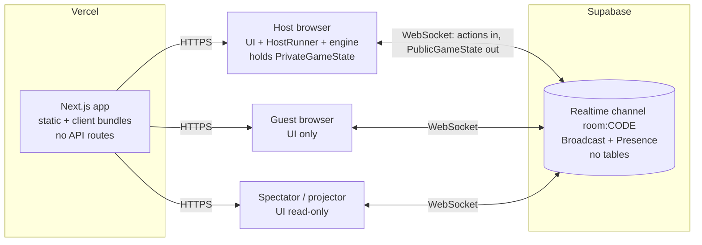
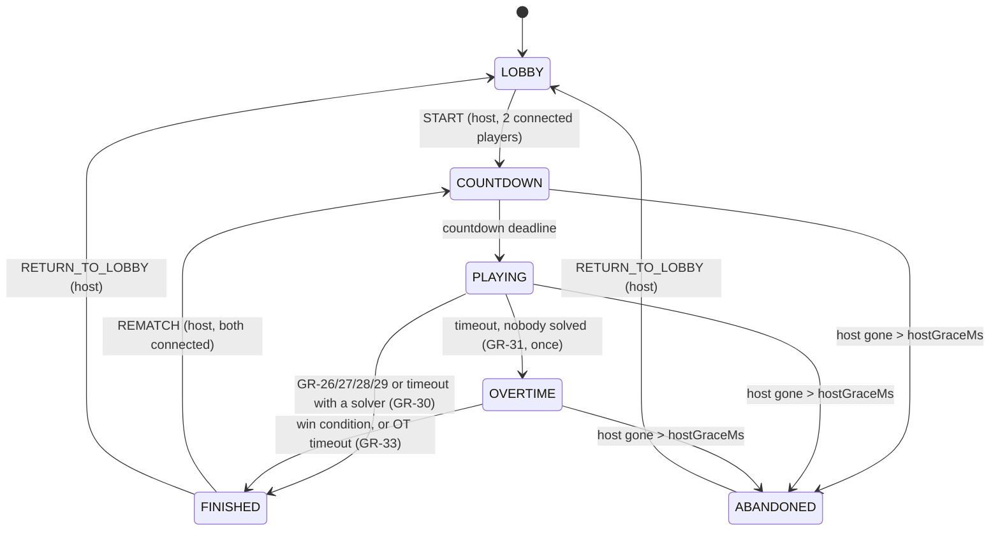
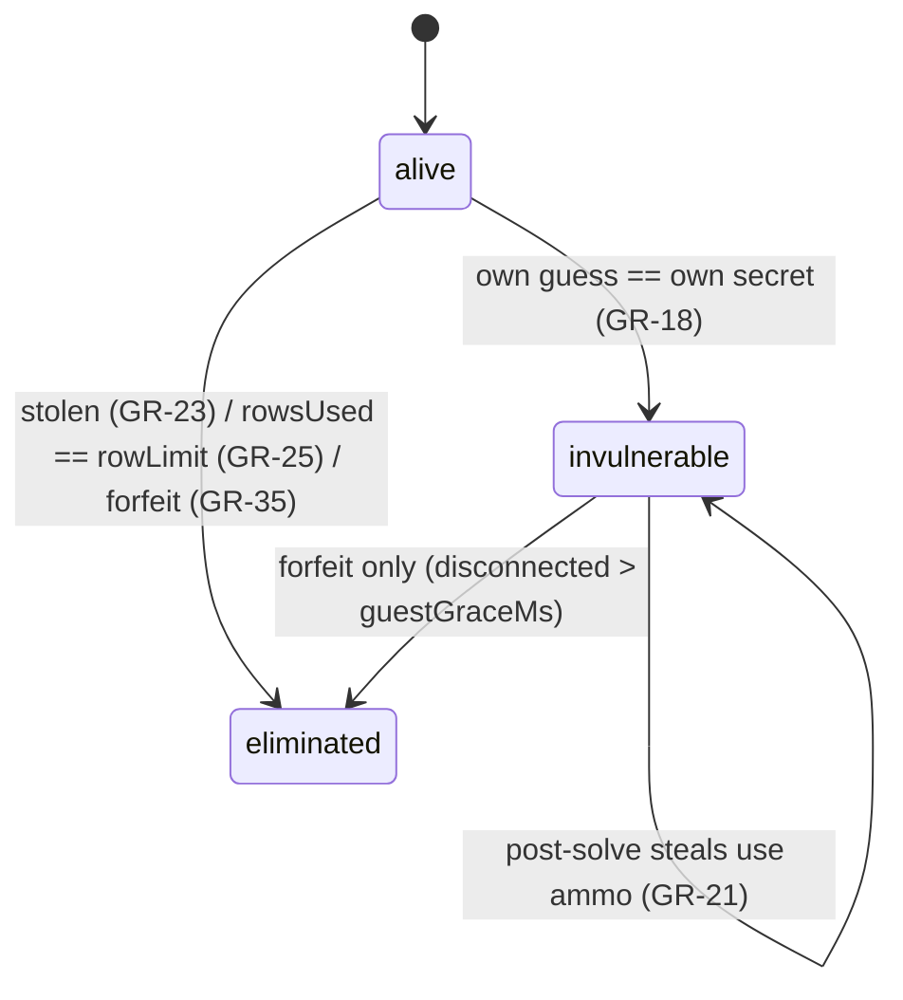

# Word Royale — Architecture (release 1.0, 2-player duel)

This document describes how the shipped code works. Requirements are in [SRS.md](SRS.md); where the
implementation deviates from the SRS, the *Implementation addendum* at the end of the SRS explains why.

## 1. Overview



- **No server-side game logic.** Vercel serves the app, and Supabase Realtime is only a relay.
- **The host browser is the referee** (SRS D-13). Its `HostRunner` owns the only copy of the authoritative
  state, including both secret words. It applies actions one at a time and broadcasts a *redacted* snapshot
  after every change.
- **Guests and spectators are thin clients.** They send intents (`GUESS`, `STEAL`, …) and render whatever
  the referee says. They never decide whether a word solved, stole or won.

For development and the Playwright suite, `scripts/relay.mjs` (a ~100-line WebSocket server) stands in for
Supabase with the same Broadcast (`self: true`) and Presence semantics. It is selected by
`NEXT_PUBLIC_REALTIME_TRANSPORT=local`, or automatically in dev when Supabase is not configured. It is
never deployed.

## 2. Module map and dependency rule

```
components/  ──►  lib/client/  ──►  lib/realtime/  ──►  lib/engine/
 (React UI)       (RoomClient,      (transport,         (pure rules:
                   zustand store,    protocol,           reducer, outcome,
                   copy, identity)   HostRunner)         pairing, scoring,
                                                         settings, projection)
```

Dependencies point **only to the right**. `lib/engine` has no React, Supabase or browser imports, and
calls neither `Date.now()` nor `Math.random()`: time and randomness are injected (NFR-8, NFR-13). ESLint
enforces this with `no-restricted-imports` and `no-explicit-any` on `lib/engine/**`. No gameplay rule
lives in a React component (FIX 2). Components call `RoomClient` methods and read the store.

| Module | Responsibility |
|---|---|
| `lib/engine/types.ts` | `PrivateGameState` / `PublicGameState`, players, rows, actions, events, rejections |
| `lib/engine/settings.ts` | `DEFAULT_SETTINGS`, `DEBUG_SETTINGS`, `validateSettings`, `resolveSettings` (FIX 3) |
| `lib/engine/score.ts` | GR-16 two-pass tile scoring |
| `lib/engine/secrets.ts` | GR-2 distinct secret selection (partial Fisher–Yates) |
| `lib/engine/pairing.ts` | Who fights whom: random symmetric opponent pairs (`pairPlayers`), `isOpponent`, stealability |
| `lib/engine/outcome.ts` | Win/draw evaluation GR-26…29 and timeout outcomes GR-30/33 |
| `lib/engine/reducer.ts` | `reduce(state, action, {now, rng, dictionary})` — the referee |
| `lib/engine/state.ts` | Lobby state plus the roster rules shared by referee and UI (`isBattleRoyale`, `nextMatchSize`, `playersStillHere`, `isWaitingForSeat`) |
| `lib/engine/project.ts` | `toPublicState()` whitelist projection plus the `findLeakedSecrets()` tripwire (FIX 1) |
| `lib/realtime/transport.ts` | `RoomTransport` interface, outbound queue while offline, transport selection |
| `lib/realtime/supabaseTransport.ts` / `localTransport.ts` | Supabase Realtime and dev-relay implementations |
| `lib/realtime/protocol.ts` | Event names and payload types, plus runtime validation of untrusted payloads |
| `lib/realtime/wire.ts` | Compact wire encoding: full snapshots, deltas, gap detection |
| `lib/realtime/hostRunner.ts` | Referee loop: FIFO dispatch, 250 ms TICK, presence diffing, persistence, broadcast |
| `lib/client/roomClient.ts` | Per-page controller: input, client-side validation, pending/ack, clock offset, host-absence detection, draft mirroring |
| `lib/client/store.ts` | Zustand store read by the UI |
| `lib/client/players.ts` / `arenaLayout.ts` | Pure UI helpers: player lookups and counts; spectator-arena grid packing |
| `lib/client/theme.ts` | Display preferences: storage keys, theme colours, the pre-paint `<head>` script |
| `components/hooks.ts` | Shared React hooks: host-clock countdown, latest game event, element size, temporary flags |

## 3. Private vs public state (FIX 1)

```ts
PrivatePlayer extends PublicPlayer { secret: string }        // host memory + host sessionStorage only
PrivateGameState { players: PrivatePlayer[]; rowCounter; eventCounter; … }
PublicGameState  { players: PublicPlayer[]; hostNow; revealedSecrets?; … }   // the only thing ever sent
```

- `toPublicState(private, hostNow)` is a **whitelist** projection: every public field is copied
  explicitly, so adding a private field can never leak it by accident.
- `revealedSecrets` is filled **only when `phase === 'FINISHED'`** (FR-6.2). Abandoned matches reveal nothing.
- Every snapshot the host is about to broadcast in development (and in `?debug=1`) passes through
  `findLeakedSecrets()`. If an alive player's secret appears as any JSON string value other than a guessed
  word or a nickname, the broadcast is **blocked** and logged. A solved player's word legitimately appears
  on their own board, because they are invulnerable by then.
- Tests cover this at three levels:
  - **Unit:** projection of every phase, with and without solves.
  - **HostRunner:** every message broadcast through a full match.
  - **E2E:** every raw WebSocket frame the guest browser receives during play.

The host browser still holds both secrets, which is the accepted limitation of a browser referee (§9).

## 4. Realtime protocol

Channel `room:{CODE}`. Broadcast uses `self: true`, so **the host's own actions travel the same
relay path as guests' actions**. That keeps FIFO ordering fair between host and guest. Presence is keyed
by `playerId`, with payload `{ playerId, nickname, role: host|player|spectator, joinedAt }`.

| Event | Direction | Payload | Notes |
|---|---|---|---|
| `action` | client → host | `ClientAction` | `START`, `GUESS`, `STEAL`, `REMATCH`, `RETURN_TO_LOBBY`, `UPDATE_SETTINGS`. Each carries `playerId` and a per-player increasing `clientSeq`. Shape-validated by `parseClientAction()`; unknown fields are dropped. |
| `state` | host → all | full `WireState` (compact `PublicGameState`) | First sync, on `sync_request` / reconnect, and at least every 20 s. |
| `state_delta` | host → all | `WireDelta` | Only what changed since the previous broadcast. Immediate in a duel, batched every 100 ms in bigger games. A clock-only heartbeat goes out every 3 s. A client whose version does not match `base` requests a full snapshot. |
| `reject` | host → all | `{ playerId, clientSeq, reason }` | Clients filter by their own id. |
| `draft` | player → all | `{ playerId, letters, mode, targetId, matchNumber }` | Live typing (GR-8). Throttled to ≤ 10/s, dropped while offline, never refereed. |
| `sync_request` | client → host | `{ playerId }` | Sent on every (re)connect. Bursts are coalesced. |

```mermaid
sequenceDiagram
    participant G as Guest RoomClient
    participant RT as room:CODE
    participant H as Host HostRunner
    G->>G: validate locally (length, dictionary, duplicate, target) — shake + toast on failure
    G->>G: show PENDING row immediately; block further submits
    G->>RT: action {STEAL, playerId, targetId, word, clientSeq: 7}
    RT->>H: action
    H->>H: parse → reduce(): apply due deadlines first, then the action
    alt rejected
        H->>RT: reject {playerId, clientSeq: 7, reason}
    end
    H->>RT: state {version++, hostNow, players[guest].lastSeq = 7, …}
    RT->>G: state → pending cleared (ack), latency recorded, tiles flip
```

**Acknowledgement (FIX 4).** Every processed action, accepted *or* rejected, sets
`players[i].lastSeq = clientSeq` in the next snapshot. A client clears its pending row when
`lastSeq ≥ pending.clientSeq` and records the submit→confirmation time. The `?debug=1` panel shows
p50/p95/max of the last 50. If no ack arrives:

| Time without ack | Client does |
|---|---|
| 3 s | sends `sync_request` |
| 6 s | resends the **same** action, same `clientSeq` (the host ignores it if it was already processed and just resends state) |
| 15 s | gives up, restores the draft, and shows a toast |

**Versioning and clock.** `version` increases on every change, and clients drop snapshots whose version is
not newer. Every snapshot carries `hostNow`. Clients estimate `offset = max(recent hostNow − Date.now())`
and render timers from the absolute `phaseEndsAt`.

**Animations never block the engine (FIX 4).** Rows appear in state immediately. The 250 ms per tile /
100 ms stagger flip is pure CSS on the client and plays once per row id. Overlays (steal shatter, overtime
"winged god", banners) are driven by the snapshot's `lastEvents`, which carry monotonically increasing ids,
so every screen plays the same animation for the same event. All overlays have `pointer-events: none`;
input is never paused.

## 5. Ordering and conflict resolution (FIX 6)

1. **Strict FIFO.** `HostRunner.dispatch()` is synchronous, so actions are applied fully, including all win
   checks, in the order the host receives them (SRS §5).
2. **Deadlines before actions.** `reduce()` first applies every due deadline in chronological order:
   countdown end, match timeout, overtime timeout and disconnect forfeits. Only then does it look at the
   action. A guess arriving 100 ms after the clock hit zero therefore lands *after* the timeout. It is
   either played in overtime or rejected as `not_playing`. It can never exploit the gap between 250 ms
   TICKs. This deliberately supersedes SRS E-9.
3. **Replay protection.** An action whose `clientSeq ≤ lastSeq` for that player is rejected as
   `duplicate_seq`, with no side effects. The host answers it with a fresh snapshot instead of a reject.
4. **Validate before mutate.** Phase, identity, target eligibility (via the pairing module), word format,
   dictionary, duplicates, then rows or ammo, all before any mutation. Invalid actions never consume rows.
5. **Idempotent terminal transitions.** `eliminate()` ignores an already-eliminated player, and `finish()`
   ignores a non-active match. No double elimination, no double victory.
6. **Outcome evaluation after every mutation** (`resolveOutcome`):
   1. decisive statuses: GR-26 last standing, GR-27 both solved, GR-29 nobody standing;
   2. GR-25 row exhaustion;
   3. re-evaluate, now including GR-28 *unbeatable*.

   Step 1 is why a successful steal on your final row wins (E-4). GR-28 runs after GR-25 so that an
   opponent who simply ran out of rows is reported as `opponent_out_of_rows`, not as `unbeatable` (FIX 5).
7. **Same-millisecond solves.** When two solves have equal rows and an equal `solvedAt`, the processing
   order (`solveOrder`) breaks the tie.

## 6. State machines

### Match phase



### Player status



## 7. Reliability (FIX 7)

| Concern | Implementation |
|---|---|
| Stable identity | `playerId` (random, lower-case base36) in `sessionStorage`, so it survives a refresh of the same tab. A new tab is a new player. The host claim `wr:host:{CODE}` is also in `sessionStorage`. |
| Room code collisions (E-18) | Before claiming a code, the home page joins the channel and checks Presence for an existing `host`. It tries up to 5 codes. |
| Lobby roster | `HostRunner` diffs every Presence snapshot against the engine roster: new members become `PRESENCE_JOIN`, missing ones `PRESENCE_LEAVE`. Players beyond `maxPlayers`, and anyone joining mid-match, become spectators. A would-be player waiting as a spectator is promoted when a lobby seat frees up. |
| Guest disconnect (GR-35) | Leaving during a match sets `connected=false`, `disconnectedAt`. Rejoining with the same id within 15 s restores the player. After that, they forfeit. This is checked by the clock, not by a timer, so it is deterministic. |
| Guest reconnect / refresh (E-14) | Transports auto-reconnect, re-track Presence and flush queued actions. The client sends `sync_request`. The persisted `clientSeq` plus the `lastSeq` from state keep sequence numbers monotonic. |
| Host refresh (E-15, NFR-7) | After every change the host writes the private state to `sessionStorage`, plus a 1 s heartbeat. On reload it restores the state (timers are absolute timestamps) and rebroadcasts. |
| Host gone (GR-36) | **Guests:** if host Presence is absent for > 10 s during a match, they show "Host left — game abandoned". A newer host snapshot clears this. **Host:** its own connection down > 10 s, or restoring with a heartbeat older than 10 s, means `ABANDON`, so both sides agree. |
| Connection indicator | A header dot shows connected, connecting/reconnecting or disconnected. Opponent boards show "offline". |
| Stale or forged snapshots | Clients ignore `state` with a different `roomCode`, a non-newer `version`, or (once locked on) a different `hostId`. |

## 8. Settings (FIX 3)

`GameSettings` holds plain numbers and booleans, with defaults in `DEFAULT_SETTINGS`:

| Setting | Default |
|---|---|
| match | 120 s |
| overtime | 45 s, +3 rows |
| base rows | 6 |
| post-solve steal rows | 3 |
| countdown | 3 s |
| guest grace | 15 s |
| host grace | 10 s |
| `maxPlayers` | 2 |
| `enableUnbeatableEarlyFinish` | `true` |

`validateSettings()` rejects out-of-range values. In 1.0, `maxPlayers` must be 2 and `wordLength` must
be 5, because only five-letter lists ship. The host can toggle `enableUnbeatableEarlyFinish` in the lobby
(an `UPDATE_SETTINGS` action, accepted only in `LOBBY`) or start with `?early=0`. `?debug=1` uses
`DEBUG_SETTINGS` (20 s / 10 s).

## 9. Security limitations

This is a hackathon prototype. **It is not cheat-proof, and the code does not claim to be.**

- **The host can read both secrets.** The referee runs in the host's browser, so the private state is in
  its memory and `sessionStorage`. Guests never receive an active secret over the wire.
- **No sender authentication.** Supabase anonymous channels accept any client holding the public anon key.
  A technically skilled participant could:
  - publish actions with someone else's `playerId`, or
  - publish a fake `state`.

  Mitigations are sanity checks only: payload shape validation, per-player sequence numbers, rule
  validation in the engine, and clients locking onto the first host id they follow.
- **No rate limiting** beyond Supabase's own quotas. The dev relay has none at all.
- **Nicknames** are rendered as text (React escaping), capped at 16 characters, and masked by a small
  profanity filter. The filter is conservative, for example "Scunthorpe" gets masked.

**Hardening path.** Move `reduce()` into a server authority, such as a Supabase Edge Function or a
long-lived worker; a Vercel Function alone cannot hold the match clock. Keep secrets server-side, and
authenticate players with per-player tokens. The `PrivateGameState` / `PublicGameState` split and the pure
reducer are already the shape such a move needs.

## 10. Battle royale (2–100 players)

Release 1.0 shipped as a duel. The engine was written over player arrays from the start, so the battle
royale is the same reducer with a different pairing module and a lifted cap. **With 2 players
everything behaves exactly like the duel**, and the full duel test suite still runs unchanged.

| Piece | Where | Behaviour |
|---|---|---|
| Player cap | `settings.maxPlayers` (2–100, `validateSettings`) | Host-only, lobby-only (`UPDATE_SETTINGS`). A match starts with **any** number of connected players from 2 up to the cap. A lone host can never start. Lowering the cap parks the newest non-host players as waiting spectators. |
| Late joiners | `reducer.ts` `handleJoin` / `promoteSpectators` | Anyone arriving mid-match spectates it (spectators are unlimited). Waiting spectators take free seats, up to the cap, when the host returns to the lobby **or presses Rematch**. `?watch=1` projector viewers are never promoted. |
| Opponent pairs | `pairing.ts` `pairPlayers` | **Symmetric:** every player fights exactly ONE opponent (`targetId`), and opponents are mutual: if A's is B, B's is A (A↔B, C↔D, …). Nobody chooses. At match start the referee shuffles the players (seeded rng, so a match replays identically) and pairs them off. With an odd number, one player waits for an opponent: they keep solving their own word and nobody can steal from them. With 2 players it is the classic duel. |
| Stealing | `reducer.ts` `handleSteal` → `isOpponent` | A steal is accepted only against your own opponent. The shield and eliminated checks run first, so E-2's "Shielded!" still applies. |
| Re-pairing | `reducer.ts` `retarget()` → `pairPlayers` | A successful steal knocks the opponent out and **the match continues**. After every status change (steal, out of rows, forfeit, solve), pairs that still hold are kept. Free players are then paired at random: unsolved with unsolved first, then a lone unsolved player with a solved player who still has free steal shots. In a battle royale, a pair where neither can steal from the other any more (e.g. one solved and is out of shots) splits so both can be paired again. Changes emit `TARGET_CHANGED` (toast: "New opponent" or "Waiting for a free opponent"). Invariant, checked after every action of the 100-player test: pairs are always mutual. |
| Ending and placings | `outcome.ts` | The same rules, applied over N players: last one standing; everyone still standing has solved (fewest rows, then earliest); generalised GR-28; timeout and overtime. `finish()` attaches `result.standings`: solvers by rows and time, then survivors, then eliminated players (most recently out first). The winner is always placed 1st. |

**UI.**
- **Players** keep the two-board view (their own board plus their opponent's), with an arena bar naming "⚔ Your opponent" (or "waiting for a free opponent") and alive/shielded/out counts. While waiting, the opponent board is replaced by a "Waiting for an opponent" card.
- **Spectators and the projector** get `ArenaGrid`: every player's mini board, packed live into whichever grid gives the largest tiles. Letters show once tiles are big enough, plus crown, shield and "out" markers.
- **The end screen** shows your placing and a scrollable standings table with every secret word.
- **Banners** fire only for events that concern you (your steals, being knocked out, a new best score), so 100 players do not drown the screen.

**Network at scale** (see §4):
- **Compact deltas.** Rows travel in a compact tuple form, and after the first full snapshot the host sends only what changed (`state_delta`, `lib/realtime/wire.ts`). Clients detect gaps and resync.
- **Batching.** In games with more than 2 players, broadcasts are batched (one per 100 ms).
- **Live typing** is mirrored only in games of 4 or fewer.
- **Relay routing.** The dev and self-hosted relay delivers `action` and `sync_request` **only to the host**.

**Measured** (`LOADTEST=1 npx playwright test e2e/load-100.spec.ts`: one real browser host plus 99 bot
players through the local relay, on localhost):

| Measure | Result |
|---|---|
| Guesses confirmed | 594 |
| Confirmation latency | p50 76 ms, p95 119 ms |
| Resyncs | 0 |
| Per client | ~111 deltas + 4 full snapshots ≈ 1 MB over a 24 s match |
| Referee cost | a full simulated 100-player match runs in ~0.4 ms per action (unit test) |

**Supabase at 100 players (not measured).** On Supabase, every broadcast fans out to every subscriber,
including `action` messages, which the relay routes to the host only. A 100-player match is therefore in
the order of several hundred to a few thousand delivered messages per second. That is above the
free-tier Realtime quota. Check your plan's limits, or self-host `scripts/relay.mjs` (README →
"Battle royale scale").

**Still future work:** knockout brackets and tournaments (several duels in parallel, winners
advance). These would be a module above the reducer that runs one match per pairing.

## 11. Testing strategy

- **Vitest (`npm test`, 161 tests):**
  - `lib/engine`:
    - every GR rule and SRS edge case, plus amendments (ordering, sequence numbers, leakage, the
      early-finish toggle, determinism);
    - the battle royale (`battleRoyale.test.ts`): cap, late joiners and rematch promotion, symmetric
      pairs (mutual, one waits when odd, random per seed but replayable, steals only at your opponent,
      re-pairing after steals, forfeits and stalled pairs), eliminations that do not end the match,
      every way of ending, placings, and a full 100-player match that checks pairs stay mutual after
      every action.
  - `lib/realtime`:
    - `HostRunner` against an in-memory transport that replays snapshots and deltas exactly like a
      client;
    - the wire format: lossless round trip, exact delta rebuild, gap detection, and a guess costing
      under 3 KB in a 100-player game;
    - protocol validation.
  - `lib/client`: copy, keyboard colouring, ids, nicknames, share links, spectator-arena layout, the
    pre-paint theme script (light/dark restored with the matching browser-chrome colour).
  - Test drivers: `lib/engine/__tests__/helpers.ts` (`EngineHarness`, with `Sim` for duels; the battle
    royale `BrSim` extends it) and `e2e/helpers.ts` (room creation, joining, host-roster reads).
- **Playwright (`npm run test:e2e`):** real browsers through the local relay.
  - Duel: two players and a spectator, with mirroring, invalid-word rejection, steal rows, a winning
    steal, both end screens, rematch, and a raw-WebSocket-frame secret-leak check. Guest refresh, host
    refresh, and "Room not found".
  - Battle royale: a 10-player cap started with 4 players; the cap control is host-only; random mutual
    pairs named on every screen; the first duel winner waits, then meets the other winner; a late joiner
    spectates, then plays the rematch; standings on every screen.
  - Opt-in 100-player load test (`LOADTEST=1`).
