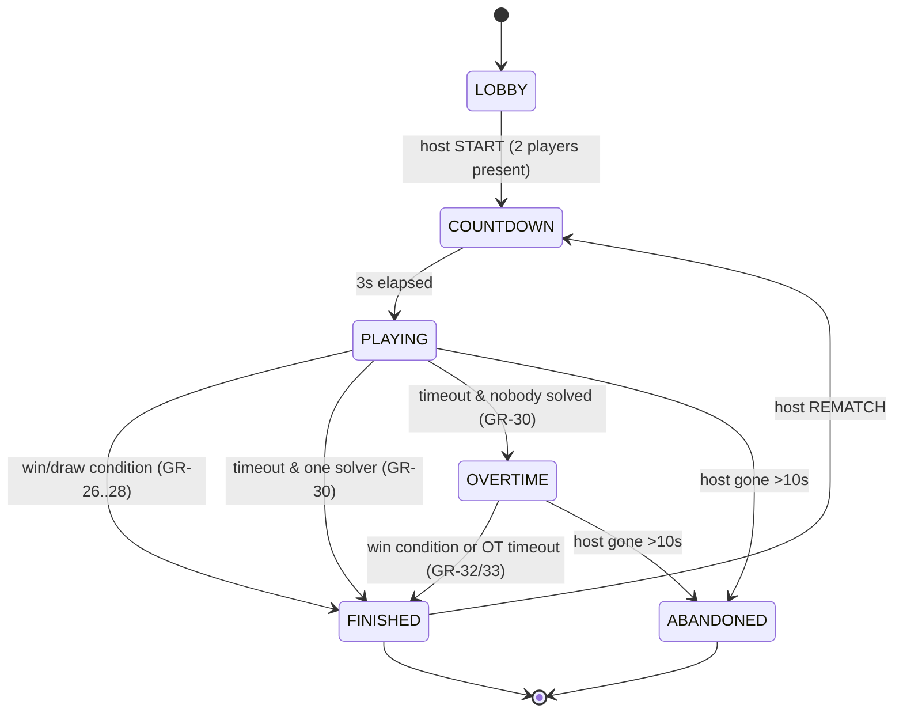
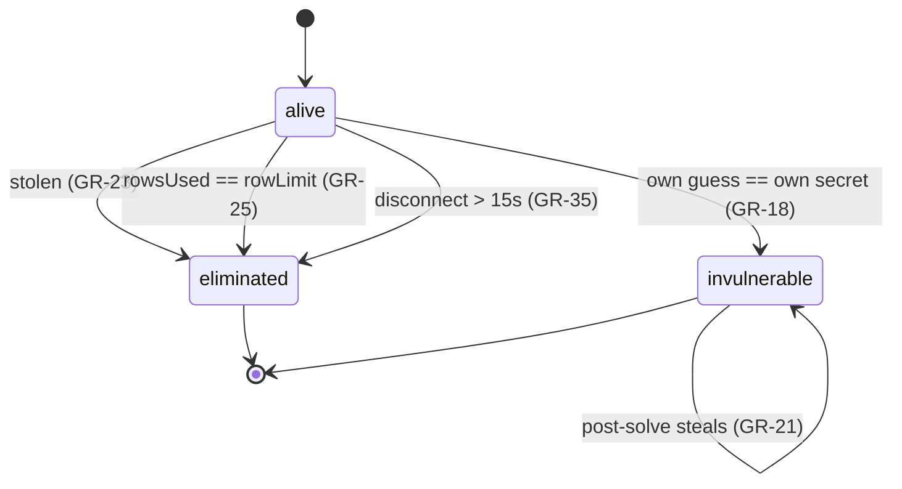
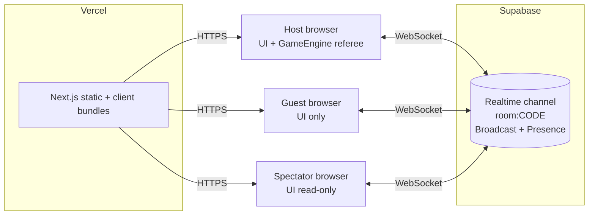
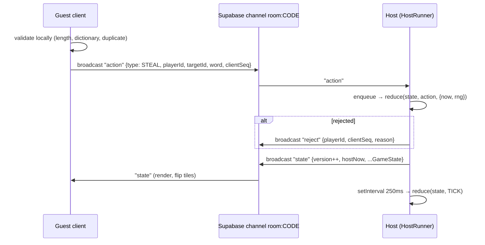

# Word Royale — Software Requirements Specification

| | |
|---|---|
| **Product** | Word Royale (working title) — a real-time, head-to-head word-guessing battle royale |
| **Version** | 1.0 (Demo release) |
| **Date** | 2026-11-20 |
| **Status** | Approved for implementation |
| **Target platform** | Web (desktop + mobile browsers), deployed on Vercel |
| **Stack** | Next.js (App Router) · React · TypeScript · Tailwind CSS · Motion · Zustand · Supabase Realtime |

> **Branding note.** The game is a genre game in the style of five-letter word-deduction puzzles. It MUST NOT use the "Wordle" name, NYT logos, NYT colour scheme verbatim, or NYT word lists. Use the working title "Word Royale" and an original visual identity.

---

## Table of contents

1. [Introduction](#1-introduction)
2. [Overall description](#2-overall-description)
3. [Gameplay rules](#3-gameplay-rules)
4. [State machines](#4-state-machines)
5. [Edge cases and conflict resolution](#5-edge-cases-and-conflict-resolution)
6. [Functional requirements](#6-functional-requirements)
7. [UI / UX requirements](#7-ui--ux-requirements)
8. [System architecture](#8-system-architecture)
9. [Data model](#9-data-model)
10. [Non-functional requirements](#10-non-functional-requirements)
11. [Deployment](#11-deployment)
12. [Testing and acceptance criteria](#12-testing-and-acceptance-criteria)
13. [Future work (N-player and beyond)](#13-future-work-n-player-and-beyond)
14. [Appendix A — Decision log](#appendix-a--decision-log)
15. [Appendix B — Assumptions to confirm](#appendix-b--assumptions-to-confirm)

---

## 1. Introduction

### 1.1 Purpose
This document specifies the requirements for **Word Royale**, a real-time competitive word game in which two players each try to deduce a secret five-letter word while simultaneously trying to eliminate their opponent by "stealing" (correctly guessing) the opponent's word. It is the single source of truth for implementation, testing, and the live demo.

### 1.2 Scope
Release 1.0 is a **2-player** game, built for a **live hackathon demo** where audience members join from their phones/laptops by scanning a QR code. The architecture and data model MUST be ready for an **N-player** battle royale in a later release, where each player still only sees two boards at a time.

**In scope:** room creation/join by code + QR, the full 2-player ruleset (own guesses, steals, invulnerability, timers, overtime), real-time board mirroring, end screen, rematch, spectator/projector view, Vercel deployment.

**Out of scope for 1.0:** accounts/auth, persistence of match history, anti-cheat/security (see §10.5), N-player UI, matchmaking queues, host migration.

### 1.3 Definitions

| Term | Definition |
|---|---|
| **Secret word** | The five-letter word assigned privately to each player. Each player tries to solve their own. |
| **Board** | A player's grid of submitted rows. |
| **Row** | One submitted five-letter guess plus its per-tile feedback. |
| **Own guess** | A row guessed against the player's *own* secret word. |
| **Steal / steal row** | A row guessed against an *opponent's* secret word. Displayed on the stealer's board, styled distinctly. |
| **Tile feedback** | `correct` (right letter, right spot), `present` (in word, wrong spot), `absent` (not in word). |
| **Row limit** | Maximum number of scoring rows a player may use (6 base; +3 in overtime). |
| **Rows used** | Count of scoring rows submitted (own guesses + pre-solve steals). |
| **Solve** | Submitting an own guess equal to your secret word. |
| **Invulnerable** | Status after solving. Cannot be stolen from or eliminated. |
| **Post-solve steal rows** | 3 bonus steal-only rows granted on solving. Do not count toward rows used. |
| **Eliminated** | Out of the game (word stolen, rows exhausted, or forfeited). |
| **Overtime (OT)** | 45-second extension triggered at match timeout when neither player has solved. Grants +3 rows each. |
| **Host** | The browser of the player who created the room. Runs the authoritative game engine (the "referee"). |
| **Spectator** | A read-only viewer (e.g. the projector). |

### 1.4 References
- IEEE 830-1998 / ISO/IEC/IEEE 29148 (structure)
- Supabase Realtime docs — Broadcast and Presence
- Next.js App Router docs; Vercel deployment docs
- SCOWL (Spell Checker Oriented Word Lists) — permissively licensed source for word lists

### 1.5 Requirement keywords
**MUST / SHOULD / MAY** per RFC 2119. Each requirement has an ID (`GR-`, `FR-`, `UI-`, `NFR-`) and a MoSCoW priority where relevant.

---

## 2. Overall description

### 2.1 Product perspective
A standalone web app. One Vercel deployment serves the Next.js frontend. Supabase Realtime acts purely as a message relay (Broadcast) and connection tracker (Presence) — **no database tables, no server-side game logic**. The game engine runs in the host player's browser.

### 2.2 User classes

| Class | Description | Needs |
|---|---|---|
| **Host player** | Creates the room on stage or at a laptop; also plays. | Big room code + QR, Start button, Rematch. |
| **Guest player** | Audience member joining on a phone or laptop. | Fast join (scan → nickname → play), works on mobile keyboard. |
| **Spectator** | Projector screen / anyone watching. | Large, readable view of both boards, timer, dramatic animations. |

### 2.3 Operating environment
- Latest two major versions of Chrome, Safari (incl. iOS), Firefox, Edge.
- Viewports from 360 px wide (phones) to 4K projectors.
- Conference Wi-Fi or mobile data (assume 50–300 ms RTT, occasional drops).

### 2.4 Constraints
- C-1: MUST deploy to Vercel with no custom server (Vercel functions cannot hold WebSockets).
- C-2: MUST be written in React + TypeScript (strict mode).
- C-3: Real-time transport MUST be Supabase Realtime (free tier acceptable).
- C-4: Security is demo-grade only (§10.5).

### 2.5 Assumptions and dependencies
- A Supabase project exists, with its URL and anon key configured as Vercel env vars.
- The host keeps their tab open for the whole match.
- Players are on the same deployment URL (no versioning between clients).

---

## 3. Gameplay rules

Rules are numbered so each can be unit-tested (§12). All numbers below are defaults stored in `GameSettings` (§9) and MUST NOT be hard-coded elsewhere.

### 3.1 Setup
- **GR-1** A match has exactly 2 players in release 1.0.
- **GR-2** On match start, each player is assigned a secret word chosen at random from the **answer list**. The two secret words MUST be different.
- **GR-3** Each player starts with `rowLimit = 6`, `rowsUsed = 0`, status `alive`, and `postSolveStealRows = 0`.
- **GR-4** A 3-second countdown precedes play. No actions are accepted during the countdown.
- **GR-5** The match timer is **2:00**, starting when the countdown ends.

### 3.2 Visibility
- **GR-6** Each player sees their own board **and a real-time copy of the opponent's board, including letters and tile colours** of every submitted row (own and steal rows).
- **GR-7** Secret words are never *displayed* to opponents until the match ends (they are present in client state, see §10.5).
- **GR-8** (SHOULD) Each player's in-progress draft (letters typed but not submitted) is mirrored to the opponent in real time.

### 3.3 Actions
Play is **simultaneous with no cooldowns**. At any time during `PLAYING` or `OVERTIME`, an `alive` or `invulnerable` player may submit one of:

- **GR-9 Own guess.** A five-letter word scored against the player's own secret word.
- **GR-10 Steal.** A five-letter word scored against a target opponent's secret word. The player selects the target by clicking the opponent's board.

### 3.4 Validation (applies to all actions)
- **GR-11** The word MUST be exactly 5 letters A–Z (case-insensitive; stored upper-case).
- **GR-12** The word MUST be in the **valid-guess list**. Invalid words are rejected; **no row is used**.
- **GR-13** A word the player has already submitted against the same target (own word or the same opponent) is rejected as a duplicate; **no row is used**.
- **GR-14** An action from an `eliminated` player, or outside `PLAYING`/`OVERTIME`, is rejected.
- **GR-15** An `alive` (unsolved) player cannot submit an own guess or a scoring steal if `rowsUsed >= rowLimit` (defensive check only, because GR-25 eliminates the player as soon as `rowsUsed === rowLimit`).

### 3.5 Scoring a row
- **GR-16** Tile feedback uses the standard two-pass algorithm so duplicate letters are handled correctly:
  1. Pass 1: for each position `i`, if `guess[i] === secret[i]` mark `correct` and consume that secret letter.
  2. Pass 2: for each remaining position, if `guess[i]` exists among the *unconsumed* secret letters, mark `present` and consume one occurrence; else `absent`.

  Example: secret `ABBEY`, guess `BOBBY` → `present, absent, correct, absent, correct`.

### 3.6 Own guesses
- **GR-17** An own guess uses one row (`rowsUsed += 1`) and is appended to the player's board with `kind: 'own'`.
- **GR-18** If the own guess equals the player's secret word, the player **solves**:
  - status → `invulnerable`
  - `solvedInRows = rowsUsed` (includes any pre-solve steal rows) — this value is locked
  - `solvedAt` = host timestamp of the action
  - `postSolveStealRows = 3`
- **GR-19** An invulnerable player can no longer submit own guesses.

### 3.7 Steals
- **GR-20** A steal MUST target an opponent whose status is `alive`. Steals against an `invulnerable` or `eliminated` player are rejected; **no row is used**. (The UI also disables this; see FR-4.4.)
- **GR-21** **Who pays for a steal:**
  - If the stealer is `alive` (unsolved), the steal uses one of their scoring rows (`rowsUsed += 1`).
  - If the stealer is `invulnerable`, the steal uses one post-solve steal row (`postSolveStealRows -= 1`). It does **not** change `rowsUsed` or `solvedInRows`. If `postSolveStealRows === 0` the steal is rejected. The player is "disarmed" but stays invulnerable.
- **GR-22** A steal row is appended to the **stealer's** board with `kind: 'steal'` and `targetId`. Its tiles are scored against the **target's** secret word. It is visible to both players (GR-6) and styled distinctly (UI-6).
- **GR-23** If the steal word equals the target's secret word, the steal **succeeds**: the target's status → `eliminated` (`eliminatedBy = stealerId`, reason `stolen`).
- **GR-24** A steal never solves the stealer's own word, even if the steal word happens to equal it.

### 3.8 Running out of rows
- **GR-25** After any row is processed (and after any steal success is applied), if an `alive` player has `rowsUsed === rowLimit`, that player is **eliminated** (reason `out_of_rows`).

### 3.9 Win conditions (2-player)
Evaluated by the engine after **every** state change, in this order:

- **GR-26 Last standing.** If exactly one player is not `eliminated`, that player wins.
- **GR-27 Both solved.** If both players are `invulnerable`: the player with the **lower `solvedInRows`** wins. If equal, the player with the **earlier `solvedAt`** wins. (Under FIFO ordering, timestamps cannot tie.)
- **GR-28 Unbeatable early finish.** If player A is `invulnerable` with `solvedInRows = rA` and player B is `alive` with `rowsUsed >= rA − 1`, then B's best possible solve would be at `rA` rows or more, which loses to A on rows or on time. The match ends immediately and **A wins** (reason `unbeatable`).
  - Corollary: if A solves on row 1, A wins instantly.
  - Otherwise B plays on, trying to solve in fewer rows than A, while A may attack with up to 3 post-solve steal rows.
- **GR-29 No winner possible.** If both players are `eliminated` in the same state transition (only possible in N-player or by forfeit edge cases), the result is a **draw**.

### 3.10 Timers and overtime
- **GR-30 Match timeout (2:00 elapsed):**
  - If exactly one player is `invulnerable` → that player wins (reason `timeout_solver`).
  - If both players are `alive` and neither has solved → enter **OVERTIME** (GR-31).
  - (Both-solved and eliminated cases are already resolved by GR-26/27.)
- **GR-31 Overtime start.** Each `alive` player gets `rowLimit += 3`. A 45-second overtime timer starts. The "winged god" animation plays (UI-12). Input is not paused.
- **GR-32 Overtime play.** All rules (own guesses, steals, solving, GR-25 elimination, GR-26–28 win checks) apply unchanged.
- **GR-33 Overtime timeout (45s elapsed):**
  - If exactly one player is `invulnerable` → that player wins.
  - If neither player has solved → **draw** ("both lose").
- **GR-34** Overtime happens at most once per match.

### 3.11 Disconnects
- **GR-35** If a guest player disconnects (Presence leave) during play, they have a **15-second grace period** to rejoin with the same `playerId`. If they don't return, they are `eliminated` (reason `forfeit`).
- **GR-36** If the **host** disconnects for more than 10 seconds, the match is **abandoned** (no winner). Remaining clients show "Host left — game abandoned" with a "Back to home" button.

### 3.12 Rematch
- **GR-37** From the end screen, the host can start a **rematch**: same room and players, new secret words, all player state reset, back to the countdown.

---

## 4. State machines

### 4.1 Match phase



### 4.2 Player status



`invulnerable` is terminal for the player's own fate. They can't be eliminated, except by forfeiting on disconnect. Forfeit applies to every status: a disconnected invulnerable player who doesn't return in 15s is also eliminated (reason `forfeit`).

---

## 5. Edge cases and conflict resolution

**Ordering principle:** the host processes actions strictly **first-in, first-out in the order it receives them** (including its own local actions, which go through the same queue). The host timestamp at processing time is authoritative for `solvedAt` and all tie-breaks. Each action is fully applied, including all win checks, before the next one is processed.

| # | Situation | Outcome |
|---|---|---|
| E-1 | A and B both submit a successful steal on each other "at the same time". | The first one the host receives wins. That target is eliminated, the match is `FINISHED`, and the second action is rejected (GR-14). |
| E-2 | B's steal of A's word arrives just after A solves their own word. | A's solve is processed first, so A is invulnerable. B's steal is rejected and B uses no row (GR-20). B sees a "Shielded!" toast. |
| E-3 | B's steal arrives just *before* A's solving guess. | B's steal succeeds, A is eliminated and B wins. A's guess is rejected. |
| E-4 | An unsolved player's last row (row 6) is a successful steal. | The steal is applied first (GR-23), so the target is eliminated and the stealer wins via GR-26 before GR-25 is checked. |
| E-5 | An unsolved player's last row is a failed steal. | The stealer is eliminated (GR-25), and the opponent wins (GR-26). |
| E-6 | An invulnerable player has used all 3 post-solve steal rows. | Further steals are rejected and the steal UI is disabled ("Out of ammo"). The match continues until GR-27/28/30 resolves it. |
| E-7 | A solves in 4 rows. B has used 2 rows. | B can still win by solving on row 3 (3 < 4), so play continues. If B then submits a non-solving row (rowsUsed = 3 ≥ 4−1), GR-28 ends the match and A wins. |
| E-8 | A solves in 4. B solves in 3 later in time. | B wins (fewer rows, GR-27). |
| E-9 | An action arrives after the match timer hits 0 but before the host's TICK processes the timeout. | The action is processed normally (FIFO). The timeout is evaluated on the next TICK. The host TICKs every 250ms, so the effective grace is ≤250ms. |
| E-10 | An action arrives after the transition to `FINISHED`. | Rejected (GR-14). |
| E-11 | An invalid word (not in the dictionary). | Rejected client-side immediately (shake animation). If it reaches the host anyway, the host rejects it too. No row is used. |
| E-12 | A duplicate word against the same target. | Rejected (GR-13) with a toast saying "Already tried". No row is used. |
| E-13 | A player clicks the opponent's board while the opponent is invulnerable. | Nothing happens. The opponent's board is greyed out with a shield icon. |
| E-14 | A guest refreshes the page mid-match. | Their `playerId` persists in `sessionStorage`. They rejoin the channel, the host re-sends full state, and play resumes within the grace period (GR-35). |
| E-15 | The host refreshes the page mid-match. | The host persists `GameState` to `sessionStorage` after every change. On reload it restores the state, recomputes timers from absolute timestamps, and rebroadcasts. If it isn't back within 10s, GR-36 applies. |
| E-16 | A third person opens the room link during a 2-player match. | They join as a **spectator** (read-only). |
| E-17 | Someone opens the room link before the host is present, or for a room code that doesn't exist. | After 5s with no host present: "Room not found" plus a link home. |
| E-18 | The host's generated room code is already in use (a host is present on that channel). | Regenerate the code (check Presence before claiming it). |
| E-19 | Both players run out of rows in overtime. | Under FIFO processing, one player always runs out first. That player is eliminated and the other wins (GR-25/26). A draw only happens on overtime timeout with nobody solved (GR-33). |
| E-20 | A player types their own secret word as a *steal*. | It's scored against the target only. It does not solve their own word (GR-24). |

---

## 6. Functional requirements

### 6.1 Home and room creation
- **FR-1.1 (M)** The home page `/` shows: game title, a nickname input (1–16 characters, trimmed, persisted in `localStorage`), **Create room**, and **Join room** (4-letter code input).
- **FR-1.2 (M)** **Create room** generates a random 4-letter code from an unambiguous alphabet (no `I`, `O`, `0`, `1`). It is checked against Presence (E-18), then the user goes to `/room/{CODE}` as host.
- **FR-1.3 (M)** Host identity is stored in `sessionStorage` (`wr:host:{CODE} = playerId`), so a host refresh restores host status.
- **FR-1.4 (M)** **Join room** goes to `/room/{CODE}`. If no nickname is set, the room page asks for one before joining.

### 6.2 Lobby
- **FR-2.1 (M)** The lobby shows the room code in large type, a **QR code** encoding the full room URL (`https://<deployment>/room/{CODE}`), and a list of connected players with a host badge.
- **FR-2.2 (M)** The **Start** button is visible to the host only, and enabled only when exactly 2 players are connected.
- **FR-2.3 (M)** Players beyond the second join as spectators (E-16) and are listed separately.
- **FR-2.4 (S)** A "Copy link" button.
- **FR-2.5 (S)** A short "How to play" panel (5 bullet points) is shown in the lobby.

### 6.3 Own-board input
- **FR-3.1 (M)** Players type with the physical keyboard (A–Z, Backspace, Enter) or an on-screen keyboard.
- **FR-3.2 (M)** The draft row fills left to right, up to 5 letters. Enter submits. Backspace deletes the last letter.
- **FR-3.3 (M)** Client-side validation (GR-11/12/13) runs before sending. An invalid word triggers a row shake and a toast ("Not in word list", "Already tried").
- **FR-3.4 (M)** After a valid submission, the row shows as **pending** (letters visible, tiles unflipped) until the host's state confirms it. Then the tiles flip left to right with a 100ms stagger.
- **FR-3.5 (M)** The on-screen keyboard colours each key with the best known state for the **current mode's target**. In own mode, that comes from the player's own rows. In steal mode, it comes from the opponent's own rows plus the player's steal rows against that opponent.
- **FR-3.6 (S)** Draft letters are broadcast (throttled to 10/s) so the opponent sees typing live (GR-8).

### 6.4 Steal mode
- **FR-4.1 (M)** Clicking or tapping the opponent's board enters **steal mode**. The opponent board shows a red crosshair glow and a "⚔ STEAL" label. The player's draft row turns red and shows "→ {opponent}".
- **FR-4.2 (M)** **Esc**, clicking your own board, or pressing a "Back to my board" button returns to own mode. The **Tab** key toggles between modes.
- **FR-4.3 (M)** The draft is kept when switching modes.
- **FR-4.4 (M)** Steal mode is unavailable when the target is `invulnerable`/`eliminated` (shield icon, no hover effect), or when an invulnerable player has 0 post-solve steal rows ("Out of ammo").
- **FR-4.5 (M)** A failed steal's row shows on the stealer's board in steal styling (UI-6). The target sees a brief "{name} is attacking!" flash on their own board.
- **FR-4.6 (M)** A successful steal plays a "STOLEN!" shatter animation on the target's board. The match then goes to the end screen.
- **FR-4.7 (M)** Once a player solves, their UI enters steal mode by default (own guesses are no longer possible), shows "SHIELDED" with a shield icon, and shows 3 ammo pips.

### 6.5 HUD
- **FR-5.1 (M)** A central timer shows `m:ss`. It turns red under 0:20 and pulses under 0:10. In overtime it shows "OVERTIME" and a 45s countdown.
- **FR-5.2 (M)** Each board header shows: nickname, status (Alive / Shielded / Eliminated), rows used / row limit, and ammo pips once solved.
- **FR-5.3 (M)** When a player solves, both screens show a banner: "{name} solved in N rows — beat N−1 or fewer to win!" (for the opponent) or "Shielded! Hunt them down." (for the solver).
- **FR-5.4 (S)** A toast queue (max 3 visible) for rejections and events.

### 6.6 End screen
- **FR-6.1 (M)** Shows the outcome (You win / You lose / Draw) and a reason, e.g. "Word stolen", "Solved in fewer rows", "Solved first on the same row count", "Out of rows", "Opponent can't catch up", "Time — solver wins", "Overtime expired — everybody loses", "Opponent forfeited".
- **FR-6.2 (M)** Reveals both secret words and shows both full boards.
- **FR-6.3 (M)** The host sees **Rematch** (GR-37). Guests see "Waiting for host…". Everyone sees **Leave**.
- **FR-6.4 (C)** Confetti for the winner.

### 6.7 Spectator / projector view
- **FR-7.1 (S)** `/room/{CODE}?watch=1`, or any extra joiner, gets a read-only view of both boards at large size, with the timer and event banners. **Letters are shown**, since the boards are public anyway.
- **FR-7.2 (C)** The spectator view can optionally show both secret words to the audience ("dramatic irony" toggle). It's off by default.

---

## 7. UI / UX requirements

- **UI-1 Layout (desktop ≥ 768px):** a split screen with your board on the left and the opponent's board on the right, separated by the timer column. The keyboard sits centred below.
- **UI-2 Layout (mobile < 768px):** boards stay **side by side** with tile size clamped to `clamp(28px, 8vw, 56px)`. The opponent board is rendered at 85% scale. The keyboard is pinned to the bottom (safe-area aware). No horizontal page scroll.
- **UI-3** Grid rows render to the player's current `rowLimit` (6, or 9 in overtime). The 3 new overtime rows animate in. Post-solve steal rows render as a separate "ammo tray" of 3 rows under the board.
- **UI-4 Palette:** original colours (not NYT's). Example: correct = teal `#14b8a6`, present = amber `#f59e0b`, absent = slate `#475569`. Dark theme by default (better on projectors).
- **UI-5 Colour-blind mode (S):** a toggle switches to a high-contrast blue/orange palette and adds glyph markers (● correct, ◐ present).
- **UI-6 Steal rows:** red outer border, ⚔ icon in the margin, and a small label with the target's name. The tiles still use the standard feedback colours.
- **UI-7 Invulnerable board:** gold glow and a shield icon in the header. On the opponent's screen it is desaturated with a "not-allowed" cursor.
- **UI-8 Eliminated board:** greyscale, cracked overlay, and an "ELIMINATED" stamp.
- **UI-9 Projector mode (S):** `?big=1` scales everything 1.5× and hides the keyboard on spectator screens.
- **UI-10 Animations (Motion):** tile flip (rotateX, 250ms each, 100ms stagger), row shake (invalid), pop on letter entry, steal-hit shatter, shield shimmer, and banner slide-ins. All MUST respect `prefers-reduced-motion`.
- **UI-11 Sound (C):** optional SFX (key tick, flip, steal, eliminated), muted by default, with a toggle in the header.
- **UI-12 Overtime "winged god":** a full-screen 2-second overlay. A winged figure (original SVG) flies in from the top, drops "+3" onto each alive board, and flies off. Non-blocking: input stays live underneath.
- **UI-13 Accessibility:** the keyboard is fully operable. Tiles have `aria-label`s ("C, correct"). Banners use an `aria-live="polite"` region. Contrast is ≥ 4.5:1 for text.

### 7.1 Wireframe — desktop, in play

```
+----------------------------------------------------------------------------+
|  WORD ROYALE        Room: KXQT               ⏱ 1:42            [🔊] [◐]   |
+---------------------------------+----------+-------------------------------+
|  YOU · cyrus      Alive  3/6    |          |  sam        Alive  2/6        |
|  [C][R][A][N][E]                |          |  [S][L][A][T][E]              |
|  [P][I][O][U][S]                |   1:42   |  [M][O][U][N][T]              |
|  ⚔[M][O][U][N][D] → sam         |          |  [ ][ ][ ][ ][ ]  ← typing... |
|  [ ][ ][ ][ ][ ]   ← draft      |          |  [ ][ ][ ][ ][ ]              |
|  [ ][ ][ ][ ][ ]                |          |  [ ][ ][ ][ ][ ]              |
|  [ ][ ][ ][ ][ ]                |          |  [ ][ ][ ][ ][ ]              |
|                                 |          |   (click to ⚔ STEAL)          |
+---------------------------------+----------+-------------------------------+
|        Q  W  E  R  T  Y  U  I  O  P                                        |
|         A  S  D  F  G  H  J  K  L                                          |
|       ENTER  Z  X  C  V  B  N  M  ⌫        Mode: [MY WORD] / [STEAL ⚔]    |
+----------------------------------------------------------------------------+
```

### 7.2 Wireframe — lobby

```
+-------------------------------------------+
|              WORD ROYALE                  |
|                                           |
|        Room code:   K X Q T               |
|        ┌───────────┐                      |
|        │  QR CODE  │   Scan to join       |
|        └───────────┘                      |
|                                           |
|   Players (2/2):  ★ cyrus (host)   sam    |
|   Spectators: 3                           |
|                                           |
|            [   START GAME   ]             |
+-------------------------------------------+
```

---

## 8. System architecture

### 8.1 Overview



- **Vercel** only serves the Next.js app. No API routes are required in 1.0.
- **Supabase Realtime** is used as a pub/sub relay. No Postgres tables, no Row Level Security, no migrations.
- The **host browser** runs `HostRunner`, which owns the authoritative `GameState`, processes the action queue through the pure `reduce()` engine, runs the TICK interval, and broadcasts state.

### 8.2 Host-referee message flow



### 8.3 Channel and events
- Channel name: `room:{CODE}`, created with `{ config: { broadcast: { self: true }, presence: { key: playerId } } }`.
- Presence payload: `{ playerId, nickname, role: 'host' | 'player' | 'spectator', joinedAt }`.

| Event | Direction | Payload | Notes |
|---|---|---|---|
| `action` | client → host | `ClientAction` | All gameplay intents. The host also routes its own actions here. |
| `state` | host → all | `GameState` | Full snapshot, sent after every change. Small (< 10 KB). |
| `reject` | host → all | `{ playerId, clientSeq, reason }` | Clients filter by their own `playerId`. |
| `draft` | player → all | `{ playerId, letters, mode, targetId? }` | Ephemeral, not refereed, throttled to 10/s. |
| `sync_request` | client → host | `{ playerId }` | Sent on (re)join. The host replies with `state`. |

- Clients ignore any `state` whose `version` is ≤ the last one applied.
- **Clock sync:** every `state` carries `hostNow`. Clients compute `offset = hostNow − Date.now()` (smoothed) and render the timer from `phaseEndsAt − (Date.now() + offset)`.

### 8.4 Engine design (pure, testable)

```ts
// lib/engine/reducer.ts
export function reduce(
  state: GameState,
  action: EngineAction,
  ctx: { now: number; rng: () => number; dictionary: WordDictionary }
): { state: GameState; rejections: Rejection[]; events: GameEvent[] };
```

- No I/O, no `Date.now()`, and no `Math.random()` inside the engine. Time and randomness are injected through `ctx` for deterministic tests.
- `EngineAction = ClientAction | { type: 'TICK' } | { type: 'PRESENCE_LEAVE' | 'PRESENCE_JOIN'; playerId }`.
- Every successful mutation ends with `resolveOutcome(state, now)`, which implements GR-25 → GR-29 for N players (2p is the special case).
- `events` (e.g. `STEAL_HIT`, `SOLVED`, `OVERTIME_START`) are included in the broadcast state as `lastEvents` so all clients can trigger the same animations.

### 8.5 Libraries

| Concern | Library | Notes |
|---|---|---|
| Framework | `next` (latest stable, App Router), `react`, `react-dom` | Zero-config on Vercel. |
| Language | `typescript` (strict) | |
| Styling | `tailwindcss` v4 | Design tokens as CSS variables. |
| Animation | `motion` (`motion/react`) | Formerly Framer Motion. |
| Client state | `zustand` | One store: `{ gameState, me, mode, draft, toasts }`. |
| Realtime | `@supabase/supabase-js` v2 | Broadcast + Presence only. |
| QR | `qrcode.react` | `<QRCodeSVG>`. |
| Confetti (C) | `canvas-confetti` | |
| Unit tests | `vitest` | Engine + scoring. |
| E2E | `@playwright/test` | Two browser contexts. |
| Lint/format | `eslint` (next config), `prettier` | |

Pin exact versions in `package.json` at scaffold time.

### 8.6 Directory layout

```
/
├─ app/
│  ├─ layout.tsx
│  ├─ page.tsx                    # Home: nickname, create/join
│  ├─ globals.css
│  └─ room/[code]/page.tsx        # Lobby → Game → End (by phase)
├─ components/
│  ├─ Board.tsx  Row.tsx  Tile.tsx  AmmoTray.tsx
│  ├─ Keyboard.tsx  Hud.tsx  Timer.tsx  Toasts.tsx
│  ├─ Lobby.tsx  QrJoin.tsx  EndScreen.tsx
│  └─ OvertimeGod.tsx  StealOverlay.tsx
├─ lib/
│  ├─ engine/
│  │  ├─ types.ts                # GameState, Player, Row, actions
│  │  ├─ settings.ts             # DEFAULT_SETTINGS
│  │  ├─ score.ts                # GR-16 two-pass scoring
│  │  ├─ reducer.ts              # reduce()
│  │  ├─ resolve.ts              # resolveOutcome() GR-25..29, timers GR-30..34
│  │  └─ __tests__/*.test.ts
│  ├─ realtime/
│  │  ├─ supabase.ts             # client singleton
│  │  ├─ channel.ts              # join channel, typed send/on helpers
│  │  ├─ hostRunner.ts           # queue, tick loop, persistence, broadcast
│  │  └─ useRoom.ts              # React hook wiring channel ↔ store
│  ├─ words/
│  │  ├─ answers.ts              # ~2,000 common 5-letter words
│  │  ├─ valid.ts                # ~10–13k valid guesses (lazy-loaded)
│  │  └─ index.ts                # Set-based isValid(), pickSecrets()
│  ├─ store.ts                   # zustand
│  └─ id.ts                      # playerId, room codes
├─ e2e/two-player.spec.ts
├─ docs/SRS.md
└─ .env.example                  # NEXT_PUBLIC_SUPABASE_URL, NEXT_PUBLIC_SUPABASE_ANON_KEY
```

### 8.7 Word lists
- **Answer list:** about 2,000 common, non-offensive five-letter words, filtered from a permissively licensed source (e.g. SCOWL size ≤ 35), with proper nouns and plurals ending in "S" removed. Curate it manually for profanity.
- **Valid-guess list:** the answer list plus a larger SCOWL size (≤ 70), giving about 10–13k words.
- The valid list is code-split (`import()`) and loaded while the lobby is displayed.

---

## 9. Data model

```ts
// lib/engine/types.ts
export type TileState = 'correct' | 'present' | 'absent';
export type Phase = 'LOBBY' | 'COUNTDOWN' | 'PLAYING' | 'OVERTIME' | 'FINISHED' | 'ABANDONED';
export type PlayerStatus = 'alive' | 'invulnerable' | 'eliminated';
export type EliminationReason = 'stolen' | 'out_of_rows' | 'forfeit';

export interface GameSettings {
  wordLength: 5;
  baseRows: 6;              // GR-3
  overtimeExtraRows: 3;     // GR-31
  postSolveStealRows: 3;    // GR-18
  countdownMs: 3_000;       // GR-4
  matchMs: 120_000;         // GR-5
  overtimeMs: 45_000;       // GR-31
  guestGraceMs: 15_000;     // GR-35
  hostGraceMs: 10_000;      // GR-36
  maxPlayers: 2;            // N in future
}

export interface Row {
  id: string;
  word: string;               // upper-case
  tiles: TileState[];         // length 5
  kind: 'own' | 'steal';
  targetId: string;           // == owner id for 'own'
  scoring: boolean;           // false for post-solve steal rows
  at: number;                 // host timestamp
}

export interface Player {
  id: string;
  nickname: string;
  isHost: boolean;
  connected: boolean;
  disconnectedAt?: number;
  status: PlayerStatus;
  secret: string;              // demo-grade: present in broadcast state (§10.5)
  rows: Row[];
  rowLimit: number;            // 6, or 9 after overtime
  rowsUsed: number;            // scoring rows only
  postSolveStealRows: number;  // 0 until solved, then 3 and counts down
  solvedInRows?: number;
  solvedAt?: number;
  eliminatedAt?: number;
  eliminatedBy?: string;       // stealer id
  eliminationReason?: EliminationReason;
  targetId?: string;           // whose board is shown on the right (N-player ready)
}

export type OutcomeReason =
  | 'stolen' | 'fewer_rows' | 'same_rows_earlier' | 'opponent_out_of_rows'
  | 'unbeatable' | 'timeout_solver' | 'forfeit' | 'overtime_expired' | 'abandoned';

export interface GameResult {
  outcome: 'win' | 'draw' | 'abandoned';
  winnerId?: string;
  reason: OutcomeReason;
}

export interface GameState {
  roomCode: string;
  version: number;           // monotonically increasing
  hostId: string;
  hostNow: number;           // host clock at broadcast
  phase: Phase;
  phaseEndsAt?: number;      // countdown/match/OT deadline (host clock)
  overtimeUsed: boolean;     // GR-34
  settings: GameSettings;
  players: Player[];         // ordered by join
  spectators: { id: string; nickname: string }[];
  result?: GameResult;
  lastEvents: GameEvent[];   // for synchronized animations
  matchNumber: number;       // increments on rematch
}

export type ClientAction =
  | { type: 'START'; playerId: string; clientSeq: number }
  | { type: 'GUESS'; playerId: string; word: string; clientSeq: number }
  | { type: 'STEAL'; playerId: string; targetId: string; word: string; clientSeq: number }
  | { type: 'REMATCH'; playerId: string; clientSeq: number };

export type GameEvent =
  | { type: 'ROW_ADDED'; playerId: string; rowId: string }
  | { type: 'SOLVED'; playerId: string; rows: number }
  | { type: 'STEAL_MISS'; stealerId: string; targetId: string }
  | { type: 'STEAL_HIT'; stealerId: string; targetId: string }
  | { type: 'ELIMINATED'; playerId: string; reason: EliminationReason }
  | { type: 'OVERTIME_START' }
  | { type: 'FINISHED'; result: GameResult };

export type RejectReason =
  | 'invalid_word' | 'duplicate' | 'target_shielded' | 'target_eliminated'
  | 'no_ammo' | 'not_playing' | 'eliminated' | 'already_solved' | 'not_host';
```

---

## 10. Non-functional requirements

### 10.1 Performance
- **NFR-1** Action-to-render latency (guest submits → both screens show the flipped row) MUST be ≤ 300ms p95 on a 100ms-RTT network.
- **NFR-2** Pending-row feedback MUST appear locally in ≤ 50ms (optimistic UI).
- **NFR-3** Animations MUST hold 60fps on a mid-range phone (2021 or newer). Animate only `transform`/`opacity`.
- **NFR-4** Initial JS for the room route SHOULD be ≤ 200 KB gzipped, excluding the lazy-loaded valid-word list.
- **NFR-5** First contentful paint ≤ 1.5s on 4G.

### 10.2 Reliability
- **NFR-6** The client MUST reconnect automatically on WebSocket drop (Supabase client default) and send `sync_request` on reconnect.
- **NFR-7** The host MUST persist `GameState` to `sessionStorage` after each change (E-15).
- **NFR-8** The engine MUST be deterministic given the same action sequence, `now` values, and RNG seed.

### 10.3 Usability
- **NFR-9** A first-time audience member MUST be able to go from scanning the QR code to the lobby in ≤ 15 seconds (one input: nickname).
- **NFR-10** The rules MUST be explainable in ≤ 5 bullets (shown in the lobby).

### 10.4 Maintainability
- **NFR-11** TypeScript `strict: true`, no `any` in `lib/engine`.
- **NFR-12** All rule constants live in `GameSettings`.
- **NFR-13** The engine has no React or Supabase imports.

### 10.5 Security (explicitly demo-grade)
- **NFR-14** This is a single-event demo. **Cheating prevention is out of scope.** Secret words are included in the broadcast `GameState`, and a player who inspects network traffic or DevTools could read them. Accepted risk.
- **NFR-15** The Supabase anon key is public by design. Do not create any database tables, so there is nothing to leak or deface.
- **NFR-16** Nicknames MUST be rendered as text (React default escaping) and capped at 16 characters. A small profanity filter SHOULD be applied (projector safety).
- **Hardening path (future):** move `reduce()` into a Vercel Route Handler or Supabase Edge Function. Store secrets server-side, and broadcast a redacted state (secrets removed) to clients.

---

## 11. Deployment

### 11.1 One-time setup
1. Create a Supabase project (free tier). No schema changes are needed. Realtime is on by default.
2. Copy the **Project URL** and **anon public key**.
3. Push the repo to GitHub and import it into Vercel (framework preset: Next.js).
4. In Vercel → Project → Settings → Environment Variables, add `NEXT_PUBLIC_SUPABASE_URL` and `NEXT_PUBLIC_SUPABASE_ANON_KEY` for Production and Preview.
5. Deploy. Each push to `main` auto-deploys.

### 11.2 Local development
```bash
cp .env.example .env.local   # fill in Supabase values
npm install
npm run dev                  # open two browsers (one incognito) at localhost:3000
npm test                     # vitest
npx playwright test          # e2e
```

### 11.3 Demo-day checklist
- [ ] Production URL loads on iOS Safari and Android Chrome over venue Wi-Fi *and* 4G.
- [ ] Check current Supabase free-tier Realtime quotas (concurrent connections, messages/sec) against the expected audience size. Draft broadcasts are the biggest message source; disable FR-3.6 if needed via `NEXT_PUBLIC_DRAFT_MIRROR=false`.
- [ ] The host laptop is plugged in, sleep is disabled, and only one host tab is open.
- [ ] The projector runs the spectator view with `?watch=1&big=1`.
- [ ] A dry-run match has been played end to end, including overtime (use `?debug=1` to shorten timers: 20s match / 10s overtime).
- [ ] The QR code is legible from the back of the room (fullscreen QR button in the lobby).

---

## 12. Testing and acceptance criteria

### 12.1 Unit tests (Vitest, `lib/engine`)
Every GR rule MUST have at least one test. Required cases:

| Test | Covers |
|---|---|
| Scoring: `ABBEY`/`BOBBY`, `SPEED`/`ERASE`, all-green, all-grey | GR-16 |
| Secrets for 2 players are distinct across 10k seeded runs | GR-2 |
| Invalid word → rejected, rowsUsed unchanged | GR-12 |
| Duplicate word → rejected | GR-13 |
| Own solve → invulnerable, solvedInRows locked, 3 ammo | GR-18 |
| Pre-solve steal counts toward rowsUsed and solvedInRows | GR-18, GR-21 |
| Post-solve steal decrements ammo only; 4th steal rejected | GR-21, E-6 |
| Steal on invulnerable target rejected, no row used | GR-20, E-2 |
| Successful steal eliminates target, stealer wins | GR-23, GR-26 |
| Last-row successful steal wins (not out-of-rows) | E-4 |
| Last-row failed steal eliminates stealer | E-5 |
| Out of rows eliminates; opponent wins | GR-25 |
| Both solve: fewer rows wins; equal rows → earlier wins | GR-27, E-8 |
| Unbeatable: A solves in 4, B at 3 rows → A wins instantly | GR-28, E-7 |
| Solve on row 1 → instant win | GR-28 |
| Timeout with one solver → solver wins | GR-30 |
| Timeout nobody solved → OVERTIME, rowLimit 9, OT once only | GR-31, GR-34 |
| OT timeout nobody solved → draw | GR-33 |
| OT out-of-rows → eliminated, other wins | GR-32, E-19 |
| Actions after FINISHED rejected | E-10 |
| Guest disconnect > 15s → forfeit | GR-35 |
| Rematch resets state with new secrets | GR-37 |

### 12.2 E2E (Playwright, two browser contexts plus one spectator)
1. Context A creates a room, B joins by URL, and A starts the game.
2. A submits a valid guess. B sees the row with the same letters and colours within 1s.
3. B enters steal mode and submits a wrong steal. Both see the steal row styled ⚔.
4. Using the test hook `?debug=1&seed=42` (deterministic secrets), A steals B's word, both see the end screen, and A sees "You win — Word stolen".
5. A clicks Rematch, and both return to the countdown.

### 12.3 Acceptance (demo readiness)
- **AC-1** Two people on different networks complete 3 consecutive matches with no desync or refresh.
- **AC-2** Each outcome path (steal, out of rows, fewer rows, same-rows-earlier, unbeatable, timeout solver, overtime draw) has been reproduced manually at least once with `?debug=1`.
- **AC-3** Works on iPhone Safari with the on-screen keyboard (no layout jump from the OS keyboard; the native keyboard is suppressed).
- **AC-4** Lighthouse performance score ≥ 85 on the home page.

---

## 13. Future work (N-player and beyond)

The 1.0 engine and data model are N-player ready. The UI is 2-player only.

- **N-player battle royale:**
  - `settings.maxPlayers = N`. Secrets are unique across all players.
  - Each player still sees **exactly 2 boards**: their own plus their current `targetId`, **assigned at random** from alive, non-invulnerable opponents.
  - When a target is eliminated or becomes invulnerable, a new random valid target is assigned, with a "New target" swoosh animation. If no valid target exists, the right panel shows "No targets — survive!"
  - A successful steal eliminates the target. The stealer continues (it doesn't win immediately).
  - Game end: when ≤ 1 player is non-eliminated, *or* every non-eliminated player is invulnerable, *or* no alive player can beat the best invulnerable score (generalised GR-28). Ranking: invulnerable players by `solvedInRows` then `solvedAt`, then alive players, then eliminated players in reverse elimination order.
  - Timeout/overtime rules generalise: at timeout, if any player has solved, rank and finish. Otherwise all alive players get +3 rows and 45s.
- **Server authority:** move the engine to a Vercel Route Handler or Supabase Edge Function, redact secrets, and validate the dictionary server-side (§10.5).
- **Host migration:** if the host drops, the next-oldest player takes over the referee role using the last broadcast state.
- **Matchmaking:** a public quick-play queue.
- **Persistence:** match history, leaderboards, ELO (Supabase Postgres).
- **Modes:** hard mode (must reuse revealed hints), 6-letter words, team mode.

---

## Appendix A — Decision log

| # | Question | Decision | Rationale |
|---|---|---|---|
| D-1 | How much of my board does the opponent see? | **Full letters + colours** | Maximum drama. Every guess you make on your own board also hands your opponent clues. |
| D-2 | Turn-based or simultaneous? | **Simultaneous, no cooldown** | Speed is part of the battle-royale feel. |
| D-3 | What does a steal cost? | **One of the stealer's own rows**. A miss shows colour feedback. | Stealing trades progress on your own word for an attack, which makes it a real choice. |
| D-4 | Out of rows without solving? | **Eliminated** | Adds pressure and prevents stalling. |
| D-5 | Both solve (stalemate in 2p)? | **Fewer rows wins; tie → earlier solve time** | Keeps the trailing player in contention after the opponent solves. |
| D-6 | Invulnerable player out of steal rows? | **3 fresh steal rows on solve**, which don't count for scoring | The attack phase stays meaningful but limited. |
| D-7 | Steal-row display | **Marked row on stealer's board, visible to both** | Transparent and dramatic for spectators. |
| D-8 | Misc rules | Valid words only. Distinct secrets. Match timer. Can't steal from an invulnerable player. | Standard fairness. |
| D-9 | Timeout with nobody solved | **Overtime: +3 rows each (winged god), 45s. If the timer runs out, both lose (draw).** | A comeback opportunity plus a spectacle. |
| D-10 | N-player opponent selection | **Random** | Simple and unpredictable. |
| D-11 | Lobby | **4-letter room code + QR** | Fastest audience onboarding. |
| D-12 | Security | **Not required (one-off demo)** | Removes the need for a backend. Hardening path documented. |
| D-13 | Referee | **Host browser** via Supabase Broadcast | No server code, no DB, instant Vercel deploy. Risk: host tab closing (mitigated by E-15/GR-36). |
| D-14 | Timers | **2:00 match / 0:45 overtime** | Short, punchy rounds for a live audience. |
| D-15 | Timeout with exactly one solver | **Solver wins immediately** | Clean ending; no pointless overtime. |
| D-16 | Frontend stack | **Next.js + Tailwind + Motion + Zustand** | Single Vercel project, best-in-class animation. |

## Appendix B — Assumptions to confirm

These were not explicitly decided during requirements gathering. They are chosen defaults that are easy to change.

| # | Assumption | Alternative |
|---|---|---|
| A-1 | GR-28 "unbeatable" early finish ends the match as soon as the unsolved player can no longer win. This follows logically from D-5. | Let play continue until rows run out (less punchy). |
| A-2 | Duplicate guesses are rejected without using a row (GR-13). | Allow duplicates (wastes a row, as in classic play). |
| A-3 | Opponent's in-progress typing is mirrored live (GR-8, SHOULD). | Show only submitted rows. |
| A-4 | Running out of rows in overtime eliminates you, so the opponent wins. "Both lose" applies only when the overtime timer expires (E-19). | Treat overtime row exhaustion as "waiting" until the timer ends. |
| A-5 | Guest disconnect grace is 15s, then forfeit. Host disconnect grace is 10s, then abandon. | Pause the timer while disconnected. |
| A-6 | Extra joiners become spectators, and a `?watch=1` projector view exists. | Reject extra joiners. |
| A-7 | Pre-solve steal rows count toward `solvedInRows`. | Count only own-board rows. |
| A-8 | Overtime rows are added on top of remaining rows (e.g. 2 left → 5 left). | Reset to exactly 3 rows. |

---

## Implementation addendum (v1.0 build, 2026-11-21)

> This section was **added during implementation**. Everything above it is the original approved SRS,
> left unchanged. Where an item below conflicts with the text above, **this addendum takes precedence**.
> Each change traces to the implementation directive's amendments (FIX 1–8) or to a fact found while
> building. Architecture details: [ARCHITECTURE.md](ARCHITECTURE.md). Deferred ideas:
> [FUTURE_FEATURES.md](FUTURE_FEATURES.md).

### Z.1 Requirement changes

| SRS item | Change | Why |
|---|---|---|
| NFR-14, §9 `Player.secret` in broadcast state, §10.5 | Secrets are **never** in normal broadcasts. There are separate `PrivateGameState` (host only) and `PublicGameState` types, joined by a whitelist projection `toPublicState()`. Secrets are revealed only in `FINISHED` (`revealedSecrets`). A dev/debug tripwire blocks any snapshot containing an active secret. | FIX 1 |
| FR-7.2 spectator "dramatic irony" toggle | **Dropped.** | It requires secrets in the broadcast (FIX 1). |
| §9 `GameSettings` literal types | Plain `number` / `boolean` fields, `DEFAULT_SETTINGS`, `validateSettings()`. Adds `enableUnbeatableEarlyFinish` (default `true`). In 1.0, `maxPlayers` is validated to 2 and `wordLength` to 5. | FIX 3 |
| GR-28 | Behind `enableUnbeatableEarlyFinish`. The host toggles it in the lobby or with `?early=0`. GR-28 is evaluated **after** GR-25, so a player who simply runs out of rows is reported as "Out of rows", never as "unbeatable". The end screen states that an unbeatable loss is not an elimination. | FIX 5 |
| E-9 (late action processed before the timeout TICK) | **Superseded.** Every action first applies all due deadlines (countdown, match, overtime, forfeits) in chronological order. A late action lands after the timeout. | FIX 6 |
| §5 ordering principle | Adds per-player `clientSeq` replay protection (`duplicate_seq`), idempotent elimination and finish, and validate-before-mutate. | FIX 6 |
| NFR-1 | Split in two. (a) **Network:** submit → authoritative-confirmation latency is measured per action (p50/p95/max in the `?debug=1` panel). The pending row shows instantly, and further submits are blocked while pending. (b) **Animation:** flips and overlays are client-only and never block the engine or input. | FIX 4 |
| GR-36 | Enforced on **both** sides. Guests show "Host left" after 10 s without host Presence. The host abandons if its own connection is down for more than 10 s, or if it restores with a heartbeat older than 10 s. | FIX 7 |
| §8.7 word lists ("SCOWL ≤ 70 → ~10–13k") | SCOWL ≤ 70 yields only ~6.5k five-letter words, so the valid list uses SCOWL **≤ 80**, giving **11,193** words. The answer list uses SCOWL ≤ 35, minus plurals, `-s`/`-ed` inflections and a curated blocklist, giving **2,014** words. | Fact found while building |
| §8.5 "latest stable" TypeScript | **TypeScript 6.0.3** (not 7.x) and **ESLint 9**. | TS 7 is the native port, and Next's build-time type-check relies on the JS compiler API. `eslint-plugin-react` 7 is not ESLint 10-ready. |

### Z.2 Data-model changes (vs §9)

- `PrivatePlayer extends PublicPlayer { secret }` and `PrivateGameState { rowCounter, eventCounter }` are
  referee-only. `PublicGameState` adds `hostNow` and `revealedSecrets?`.
- `PublicPlayer` adds:
  - `lastSeq`: the ack for the client's last processed action;
  - `solveOrder`: the final FIFO tie-break for same-millisecond solves.
- `Row` adds `hit`, which is true on the solving or stealing row.
- `spectators` entries carry `connected`, `wantsToPlay` and `joinedAt`.
- `GameResult` adds `loserId`. `OutcomeReason` adds `all_eliminated` (GR-29).
- `GameEvent`s carry an `id` (synchronized animations). New events: `MATCH_STARTED`, `PLAY_STARTED`.
  `OVERTIME_START` carries `extraRows`.
- `ClientAction` adds `RETURN_TO_LOBBY` and `UPDATE_SETTINGS` (both host only).
- `EngineAction` adds `ABANDON`. `PRESENCE_JOIN` carries `nickname` and `role`.
- `RejectReason` adds `duplicate_seq`, `invalid_target`, `no_rows`, `not_a_player`, `not_enough_players`
  and `invalid_settings`.
- The match records `playStartedAt` and `finishedAt`, so match duration is observable (FIX 5).

### Z.3 Interpretations of ambiguous requirements

- **FR-3.5 key colours** use *every public row scored against the current target's word*. In own mode
  that includes the opponent's steal rows aimed at you, which GR-6 already makes visible.
- **GR-13 duplicates** are per (player, target): the same word may be tried once as an own guess and once
  as a steal.
- **E-13:** clicking a shielded or eliminated opponent board does nothing. The board is desaturated and
  shows a shield, and the reason appears next to the mode buttons.
- **Rejected client-side words** stay in the draft so they can be edited, as in classic play.
- **Host's own actions** go through the relay (`broadcast.self = true`) like guests' actions, so FIFO
  ordering does not favour the host.

### Z.4 Small additions beyond the SRS (demo support)

- Host **"Back to lobby"** from the end or abandoned screen (`RETURN_TO_LOBBY`). It drops disconnected
  players and promotes waiting would-be players, so a new audience challenger can play in the same room
  with the same QR code.
- **Dev/test-only local WebSocket relay** (`scripts/relay.mjs`, `npm run dev:local`). It allows local and
  LAN play, and the full Playwright suite, without Supabase credentials. It is never deployed.
- **Periodic snapshot re-broadcast** every 3 s during a match (Broadcast is at-most-once), plus pending
  action resend with the same `clientSeq`.

### Z.5 Not implemented / not verified

- **UI-11** sound effects ("could") are not implemented.
- **Supabase Realtime** has not been exercised: no credentials were available during the build. All
  automated multiplayer tests ran through the local relay, which mimics Broadcast and Presence. A
  two-device match on the deployed URL is still required (§11.3).
- **NFR-4:** the room route's initial JS measured **205.5 KB gzipped**, against a 200 KB SHOULD. It
  excludes the lazy chunks: supabase-js, word lists, referee code, QR encoder and Motion features.
- **NFR-1 / 3 / 5 / 9 and AC-1…AC-4** have not been measured on real devices or networks. Local-relay ack
  latency was ~16–30 ms on localhost, which says nothing about venue Wi-Fi.
