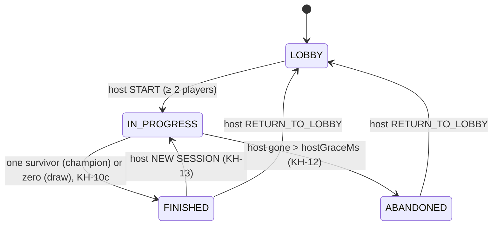
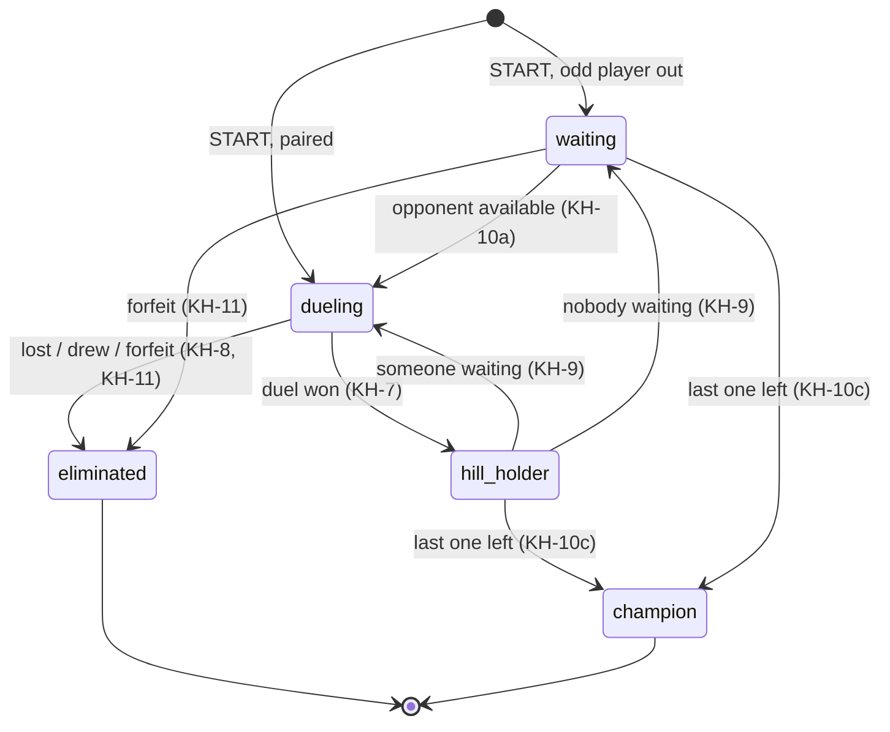

# Word Royale — SRS Amendment v1.1: King of the Hill + Spacebar toggle

| | |
|---|---|
| **Amends** | [SRS.md](SRS.md) v1.0, including its *Implementation addendum* (Z.1–Z.5) |
| **Version** | 1.1 |
| **Date** | 2026-11-21 |
| **Status** | Draft, approved for implementation |
| **Related** | [ARCHITECTURE.md §10](ARCHITECTURE.md#10-extension-points-for-the-future-battle-royale-release-fix-2) · [FUTURE_FEATURES.md §1](FUTURE_FEATURES.md#1-battle-royale--tournament-mode-the-original-vision) |

> **Precedence.** This document amends SRS v1.0 and its addendum. Where they conflict, **this document
> wins**. Anything not mentioned here is unchanged. The requirement keywords (MUST / SHOULD / MAY) and the
> ID conventions are the same as in SRS §1.5. New requirements use the prefix **`KH-`** (king of the hill).

---

## 1. Summary of changes

| ID | Affects | Change |
|---|---|---|
| KH-1 | GR-1, §1.2 scope, `GameSettings.maxPlayers`, FR-2.2 | The host sets a **player cap** (2–100, default **2**). |
| KH-2…KH-4 | GR-1, GR-6, §13 | Players are **randomly paired into symmetric 1v1 duels**. Each player sees exactly two boards: their own and their opponent's. |
| KH-5 | GR-1…GR-34 | Each duel uses the **existing 1.0 ruleset unchanged**, scoped to its two players. |
| KH-6…KH-9 | GR-26…GR-33 (meaning of "win") | **King of the hill.** A duel winner stays in and is re-paired, a duel loser is eliminated from the session, and a draw eliminates both. The last player standing is the **champion**. |
| KH-10 | — | **Waiting room.** It holds the odd player out until an opponent is free. |
| KH-11, KH-12 | GR-35, GR-36 | Disconnect handling for duels and for the waiting room. |
| KH-13 | GR-37 | Rematch becomes **New session**. |
| FR-4.2a | FR-4.2 | The **Spacebar** toggles own guess ⇄ steal (power-user shortcut). |
| §6 | FR-2, FR-5, FR-6, FR-7 | Lobby cap control, waiting-room screen, duel transitions, session end screen, multi-duel spectator view. |
| §7 | SRS §9, addendum Z.2 | `Duel` and `Session` types, `duelId` on actions, new events and reject reasons. |

**Regression guarantee:** with the default cap of 2, a session is exactly one duel and the game MUST
behave, look and test the same as release 1.0 (see KH-14).

---

## 2. Definitions (additions to SRS §1.3)

| Term | Definition |
|---|---|
| **Session** | One run from the lobby START until a champion (or a draw, or an abandon). It replaces "match" as the top-level unit of play. |
| **Duel** | One 1v1 between two players. It is played under the 1.0 rules with its own secrets, rows, countdown, clock and overtime. What 1.0 called a "match" is a duel. |
| **Opponent** | The other player in your current duel. The 1.0 `Player.targetId` field holds it. |
| **Waiting room** | Where a non-eliminated player without a duel waits for an opponent. It holds at most one player (KH-10). |
| **Hill-holder** | A player who has just won a duel and is about to be re-paired or sent to the waiting room. |
| **Streak** | The number of duels a player has won in the current session. |
| **Champion** | The last non-eliminated player in a session. |
| **Session-eliminated** | Knocked out of the session: lost a duel, drew a duel, or forfeited. Shown as a spectator from then on. |

---

## 3. King-of-the-hill rules

### 3.1 Setup and player cap
- **KH-1 Player cap.** The host sets `settings.maxPlayers` in the lobby, any whole number from **2 to 100**
  (default **2**). It uses the existing `UPDATE_SETTINGS` action and is accepted only in `LOBBY`.
  - The lobby shows `Players (n / maxPlayers)`.
  - Players who join beyond the cap become spectators flagged `wantsToPlay`. This is E-16 and the
    addendum Z.4 behaviour. They are promoted in join order when a seat frees up or the cap is raised.
  - If the host lowers the cap below the current player count, the **most recent joiners** above the cap
    are moved back to `wantsToPlay` spectators. Nobody is disconnected.
  - **Late joiners.** Anyone who joins after START is a spectator for the rest of the session and is
    seated at the next lobby.
- **KH-2 Start.** START requires **≥ 2 connected players**. This replaces "exactly 2" in GR-1 and FR-2.2.
  On START the referee:
  1. shuffles the seated players with the injected RNG (`ctx.rng`, so it is deterministic per NFR-8);
  2. pairs them in shuffled order: (1, 2), (3, 4), …;
  3. if the count is odd, puts the last shuffled player in the **waiting room**.

  So the odd player out is chosen at random.

### 3.2 Pairing and visibility
- **KH-3 Symmetric pairing.** Pairings are always symmetric: if A's opponent is B, then B's opponent is A.
  A player is in **at most one duel** at a time. No player is ever paired with themselves or with a
  session-eliminated player.
- **KH-4 Two boards only.** A player in a duel sees exactly two boards: their own and their opponent's
  (GR-6 and GR-8 apply within the duel). Players never see or interact with boards from other duels while
  they are dueling. A player can steal **only** from their current opponent (GR-10, GR-20). A steal aimed
  at anyone else is rejected (`invalid_target`).

### 3.3 Duels
- **KH-5 The duel ruleset.** Every duel runs **GR-2 … GR-34 unchanged**, scoped to its two players:
  - its own GR-4 countdown, GR-5 2:00 clock and GR-30…34 overtime;
  - own guesses, steals, invulnerability, post-solve ammo, GR-25 row exhaustion and GR-28 unbeatable
    finish;
  - the GR-26…29 win checks, all evaluated between the two duelists only.

  The duels in a session run **concurrently and independently**. Their clocks are not aligned.
  - GR-2 still applies within a duel: the two secrets MUST be different.
  - Secrets SHOULD also differ from every other live duel's secrets and from words already revealed in
    the session. If the answer list makes that impossible, uniqueness within the duel still holds.
- **KH-6 Fresh every time.** Every new pairing is a **fresh duel**. It gets:
  - new secrets for both players;
  - a reset of all per-duel player state (GR-3: rows, `rowLimit`, `rowsUsed`, `postSolveStealRows`,
    status `alive`, solve fields);
  - a new 3 s countdown and a new 2:00 clock.

  Only the **streak** and session standing carry over between duels.

### 3.4 Duel results
- **KH-7 Win.** The duel winner becomes a **hill-holder** (`streak += 1`) and is re-paired as in KH-9.
- **KH-8 Loss or draw.**
  - The duel loser is **session-eliminated**.
  - A duel draw (GR-29 or GR-33) **session-eliminates both** players.
  - A duel abandon cannot happen on its own, because abandon is session-wide (KH-12).
  - Each session elimination is appended to `eliminationOrder` and the player becomes a spectator.
    Several eliminations in one transition are appended in duel-player order and share a final rank.

### 3.5 Re-pairing, waiting room and session end
- **KH-9 Re-pairing.** After a duel ends, the referee waits for a **result beat** of `resultBeatMs`
  (default 3 s), so both players can see the outcome. Then, for each hill-holder:
  - if a player is in the waiting room, the two are paired into a fresh duel (KH-6) straight away;
  - otherwise the hill-holder enters the waiting room.

  The session-end check (KH-10c) runs first, so a sole survivor is crowned rather than sent to wait.
- **KH-10 Waiting room and session end.**
  - **(a)** If a player is waiting and another player becomes available, the two MUST be paired at once.
    It follows that **the waiting room never holds more than one player** (invariant, tested).
  - **(b)** A waiting player waits for as long as it takes. The waiting room has no timer.
  - **(c)** **Session end.** After every duel result, forfeit or session elimination:
    - if exactly **one** non-eliminated player remains and no duel is active, that player is the
      **champion**, and the session moves to `FINISHED`;
    - if **zero** non-eliminated players remain (the final duel was a draw), the session ends as a
      **draw**.

    This also covers a waiting player whose last possible opponents drew each other: the waiting player
    is the champion.
  - **(d)** **Fairness note (accepted).** The randomly chosen odd player out may play fewer duels than
    other players. Pairing is random, not by streak (D-21).

### 3.6 Disconnects
- **KH-11 Player disconnects.**
  - **In a duel:** GR-35 applies unchanged. If the player doesn't return within 15 s, they forfeit, and
    their opponent wins the duel (KH-7).
  - **In the waiting room:** if a waiting player is disconnected for more than 15 s, they are
    session-eliminated (reason `forfeit`). Then KH-10c is checked.
  - **Pairing while disconnected:** a player who is disconnected but still within the grace period MAY
    be paired. If they don't return, the GR-35 forfeit then resolves that duel.
- **KH-12 Host.**
  - GR-36 applies to the **whole session**: if the host is gone for more than 10 s, every active duel and
    the session become `ABANDONED`.
  - The host is also a player. When the host is session-eliminated, they **stay connected as the referee**
    and see the spectator view (FR-7.1). They MUST keep the tab open until the session ends.

### 3.7 New session and regression
- **KH-13 New session.** This replaces GR-37 Rematch. From the session end screen, the host can:
  - start a **New session**: same room, all connected players (including those eliminated last session)
    reshuffled, back to the countdown;
  - **Back to lobby**: the addendum Z.4 behaviour.
- **KH-14 Two-player equivalence.** With exactly 2 seated players:
  - the session MUST be exactly one duel, and its winner is the champion;
  - the 1.0 end-screen copy, the outcome reasons (FR-6.1) and all 1.0 tests MUST still pass.

---

## 4. State machines (amends SRS §4)

### 4.1 Session phase (new top level)



### 4.2 Duel phase
Each `Duel` uses the existing SRS §4.1 phase machine: `COUNTDOWN → PLAYING → (OVERTIME) → FINISHED`.
`LOBBY`, `REMATCH` and `ABANDONED` move up to the session level. A finished duel is never restarted.
Re-pairing always creates a new duel with a new `duelId`.

### 4.3 Player session status (new)



The per-duel player status (`alive / invulnerable / eliminated`, SRS §4.2) is unchanged and is reset for
every fresh duel.

---

## 5. Edge cases (continues SRS §5)

The FIFO ordering principle in §5, and addendum FIX 6 (deadlines before actions, idempotent terminal
transitions), apply **across all duels**. The single referee queue handles every duel, so the outcome is
always deterministic.

| # | Situation | Outcome |
|---|---|---|
| E-21 | 5 players at START. | Two duels; the fifth player, chosen at random, waits. |
| E-22 | Two duels end in the same host tick (both after their result beats). | FIFO decides. The first winner enters the waiting room (if empty), and the second winner is paired with them at once. |
| E-23 | 3 players: A v B, C waits. A wins. | A is paired with C. The winner of A v C is champion. |
| E-24 | 3 players: A v B draw, C waiting. | A and B are both session-eliminated, and C is champion (KH-10c). |
| E-25 | Final 2 players draw. | The session ends as a **draw**. |
| E-26 | The waiting player disconnects for more than 15 s during the only live duel. | The waiting player is eliminated. The duel's winner then becomes champion. |
| E-27 | A `GUESS` or `STEAL` arrives carrying an old `duelId` (sent just before re-pairing). | Rejected `stale_duel`. No row is used in the new duel. |
| E-28 | A `STEAL` targets a player who isn't the sender's current opponent. | Rejected `invalid_target`. |
| E-29 | The host's own duel ends (the host is eliminated) while other duels continue. | The host keeps refereeing and switches to the spectator view (KH-12). |
| E-30 | The host lowers the cap below the lobby count. | The latest joiners above the cap become `wantsToPlay` spectators (KH-1). |
| E-31 | Someone joins after START. | They are a spectator until the next lobby or New session (KH-1). |
| E-32 | A player's duel ends, but the result beat hasn't elapsed when an opponent frees up. | Pairing waits for the beat. Each hill-holder becomes available only after their own beat. |
| E-33 | A hill-holder disconnects during their result beat. | They are still paired when the beat ends. The GR-35 grace and forfeit then applies inside the new duel. |

---

## 6. Functional and UI changes

### 6.1 Lobby (amends FR-2.2, FR-2.3)
- **FR-2.2 (amended, M)** Start is visible to the host only and enabled when **≥ 2** players are
  connected.
- **FR-2.6 (new, M)** The host sees a **player cap stepper** (2–100, default 2). Guests see the cap as
  read-only. The roster header reads `Players (n / cap)`, and extra joiners are listed as "Waiting for a
  seat".
- **FR-2.5 (amended)** "How to play" gains one bullet: *"Win your duel to stay on the hill — lose and
  you're out. Last one standing is champion."* NFR-10 is relaxed to **≤ 6 bullets**.

### 6.2 Waiting room (new)
- **FR-8.1 (M)** A waiting player sees "Waiting for a challenger…", their streak (👑 × n), "Players left:
  n", and a live, read-only mini-view of the duel(s) in progress, which reuses the spectator board.
- **FR-8.2 (S)** When paired, a "New challenger: {name}" swoosh plays, then the standard 3 s countdown
  (GR-4).

### 6.3 Duel transitions (amends FR-6)
- **FR-6.5 (new, M)** **Duel end interstitial.** It is shown for the result beat (KH-9) and reuses the
  1.0 end screen content:
  - outcome and reason (FR-6.1);
  - both secrets for that duel revealed (FR-6.2);
  - both boards.
  - **Winner:** "Victory! Streak n", then either the new-challenger swoosh or the waiting room.
  - **Loser:** "Knocked out — #k of N" with a **Spectate** button (default) and a **Leave** button.
- **FR-6.3 (amended)** Rematch → **New session** (host only, KH-13). Guests see "Waiting for host…".
- **FR-6.6 (new, M)** **Session end screen.**
  - The champion is shown with a crown and confetti (FR-6.4), and their streak.
  - Final standings: champion first, then eliminated players in reverse elimination order. Players
    eliminated in the same transition share a rank.
  - The final duel's boards and secrets are shown.
- With 2 players, FR-6.5 and FR-6.6 collapse into the single 1.0 end screen (KH-14).

### 6.4 HUD (amends FR-5.2)
- **FR-5.2 (amended)** Each board header also shows the player's streak (👑 n) when n ≥ 1. When more than
  2 players are seated, the HUD shows "Players left: n · Live duels: m".

### 6.5 Spectator / projector (amends FR-7.1, UI-9)
- **FR-7.1 (amended, S)**
  - **One live duel:** the view is the same as 1.0.
  - **Several live duels:** a responsive **grid of duel cards**, each with two mini boards, names,
    streaks and that duel's clock, plus a "Waiting" chip for the waiting player.
  - The duel with the smallest gap between the two players' `rowsUsed` (and then the least time left)
    is **highlighted**.
  - When only one duel remains, it goes full-screen.
- Eliminated players and the referee host (KH-12) use this view.

### 6.6 Spacebar toggle (amends FR-4.2)
- **FR-4.2a (new, M)** Pressing **Space** during the duel's `PLAYING` or `OVERTIME` toggles
  **own guess ⇄ steal**. It is a power-user shortcut that works alongside Tab, Esc and clicking.
  1. **Eligibility.** The toggle obeys exactly the FR-4.4 rules. If steal mode is unavailable (opponent
     shielded or eliminated, or out of ammo), Space does nothing and shows the existing reason hint next
     to the mode buttons. Once the player has solved (FR-4.7), the UI is steal-only and Space is ignored.
  2. **Draft.** The draft is kept (FR-4.3). The pending-row and submit-blocked rules (addendum Z.1, NFR-1)
     are unaffected.
  3. **Key handling.**
     - The handler MUST call `preventDefault()`, so Space never scrolls the page or activates a focused
       button.
     - Key-repeat events (`event.repeat`) are ignored, so holding Space doesn't flicker the mode.
     - The handler is not active while a text input (for example the nickname field) has focus, or
       outside `PLAYING` / `OVERTIME`.
  4. **Discoverability.** The mode buttons show a small key hint, "Space ⇄", on devices with a physical
     keyboard. The on-screen keyboard is unchanged, because the existing mode buttons already toggle.
  5. **Accessibility (UI-13).** A mode change made with Space is announced in the `aria-live` region
     ("Steal mode — target {name}" / "Own word").
  6. Space can never be part of a word (GR-11), so the shortcut can't conflict with typing.

---

## 7. Data model changes (amends SRS §9 and addendum Z.2)

```ts
// lib/engine/types.ts — additions and changes (illustrative; names may be adapted)

export interface GameSettings {
  // …existing fields
  maxPlayers: number;        // KH-1: 2..100, default 2 (validateSettings drops the "must be 2" rule)
  resultBeatMs: number;      // KH-9: default 3_000 (debug: 1_500)
}

export type SessionPhase = 'LOBBY' | 'IN_PROGRESS' | 'FINISHED' | 'ABANDONED';
export type DuelPhase = 'COUNTDOWN' | 'PLAYING' | 'OVERTIME' | 'FINISHED'; // existing Phase subset
export type SessionStatus = 'waiting' | 'dueling' | 'hill_holder' | 'eliminated' | 'champion';

export interface PublicDuel {
  id: string;                     // unique per session, e.g. "d7"
  playerIds: [string, string];    // symmetric pair (KH-3)
  phase: DuelPhase;
  phaseEndsAt?: number;
  overtimeUsed: boolean;
  startedAt: number;
  finishedAt?: number;
  result?: GameResult;            // existing type; scoped to the duel
  revealedSecrets?: Record<string, string>; // only when phase === 'FINISHED' (FIX 1 rule, per duel)
}

export interface PrivateDuel extends PublicDuel {
  secrets: Record<string, string>; // host-only; never in toPublicState() output
}

export interface PublicPlayer {
  // …existing per-duel fields (rows, rowLimit, rowsUsed, status, …) describe the CURRENT duel
  duelId?: string;                 // undefined while waiting / eliminated
  targetId?: string;               // == current opponent (KH-3); already exists in 1.0
  sessionStatus: SessionStatus;
  streak: number;                  // KH-7
  eliminatedInDuelId?: string;
}

export interface SessionResult {
  outcome: 'champion' | 'draw' | 'abandoned';
  championId?: string;
  standings: { playerId: string; rank: number; streak: number }[];
}

// Session-level fields on Private/PublicGameState
//   phase: SessionPhase            (replaces the match-level phase)
//   duels: PublicDuel[]            (active and finished duels of this session)
//   waitingPlayerId?: string       (KH-10 invariant: at most one)
//   eliminationOrder: string[][]   (groups share a rank)
//   sessionResult?: SessionResult
//   sessionNumber: number          (replaces matchNumber; increments on NEW SESSION)
```

- **Actions.**
  - `GUESS` and `STEAL` add **`duelId`**. A mismatch is rejected `stale_duel` (E-27).
  - `REMATCH` is renamed to `NEW_SESSION`. The protocol parser MAY keep accepting `REMATCH` as an alias.
  - `UPDATE_SETTINGS` accepts `maxPlayers`.
- **Events** (all carry an `id`, as in the addendum; per-duel events add `duelId`):
  - `PAIRED { duelId, playerIds }`
  - `WAITING { playerId }`
  - `DUEL_FINISHED { duelId, result }`
  - `SESSION_ELIMINATED { playerId, duelId?, reason }`
  - `CHAMPION { playerId } | SESSION_DRAW`

  The existing `MATCH_STARTED`, `PLAY_STARTED`, `OVERTIME_START`, `STEAL_*`, `SOLVED`, `ROW_ADDED` and
  `FINISHED` become per-duel and carry `duelId`.
- **Reject reasons:** add `not_in_duel` (the sender is waiting, eliminated or a spectator) and
  `stale_duel`.
- **Draft payload:** `draft` adds `duelId`. Clients render drafts only for their own duel, or, as a
  spectator, for the duel cards they show.

---

## 8. Architecture notes (amends SRS §8 and ARCHITECTURE §10)

- **Layering.** Add a **`lib/engine/session.ts`** reducer above the existing duel logic, as FUTURE_FEATURES
  §1 sketches.
  - It owns pairing, the waiting room, the result beat, session eliminations and champion detection.
  - The duel rules (`reducer.ts`, `outcome.ts`, `score.ts`) are reused per duel and SHOULD need only
    scoping changes, not rule changes.
  - The engine stays pure: no I/O, and time and RNG injected (NFR-8, NFR-13).
- **Pairing.** `lib/engine/pairing.ts` is generalised from "duel" pairing to `shuffleAndPair(players, rng)`
  and `pairWithWaiting(session, playerId)`, which enforce KH-3 and the KH-10 invariant.
- **Deadlines.** The "deadlines before actions" rule (addendum FIX 6) iterates over **every** active duel
  and over the result beats, in chronological order, before applying an action.
- **Transport.** One channel, `room:{CODE}`, unchanged. The public snapshot contains every duel, still
  produced by the whitelist `toPublicState()`.
  - The `findLeakedSecrets()` tripwire MUST check the active secrets of **all** duels.
  - The snapshot size grows with N. It MUST stay < 32 KB at 100 players, which needs measuring.
- **Quotas.** Draft broadcasts scale with the number of live duels. The existing
  `NEXT_PUBLIC_DRAFT_MIRROR=false` lever (§11.3) is the fallback for large rooms. Re-check Supabase
  Realtime message and connection limits for a 100-player session, and add it to the demo-day checklist.
- **UI.** `components/GameView.tsx` already renders "my board + my current target". It needs to route by
  `sessionStatus`:
  - `dueling` → GameView for `duelId`;
  - `waiting` → waiting room;
  - `hill_holder` or just eliminated → duel interstitial;
  - `eliminated` / spectator → spectator grid;
  - `FINISHED` → session end screen.

---

## 9. Testing and acceptance (amends SRS §12)

### 9.1 Unit tests (Vitest)

| Test | Covers |
|---|---|
| Pairing is symmetric and covers every seated player exactly once (N = 2…100, seeded) | KH-2, KH-3 |
| Odd N → exactly one random waiting player; the same seed gives the same pairing | KH-2, NFR-8 |
| Waiting room never holds more than one player over random seeded sessions (property test) | KH-10a |
| Duel winner is re-paired with the waiting player after `resultBeatMs`, with a fresh duel (new secrets, rows reset) | KH-6, KH-9 |
| Duel winner with nobody waiting enters the waiting room | KH-9 |
| Duel loser is session-eliminated; a draw eliminates both | KH-8 |
| Champion detection: last survivor; waiting player after the other duel draws (E-24); final draw → session draw (E-25) | KH-10c |
| Steal at a non-opponent → `invalid_target`; old `duelId` → `stale_duel` | KH-4, E-27, E-28 |
| Waiting-player forfeit after 15 s | KH-11, E-26 |
| Host session-eliminated keeps refereeing; host gone → whole session abandoned | KH-12 |
| Cap validation (1 and 17 rejected; lowering the cap demotes the latest joiners) | KH-1, E-30 |
| **All existing 1.0 engine tests pass unchanged with N = 2** | KH-14 |
| Space-toggle eligibility helper (shielded, target ineligible, no ammo, wrong phase, input focused) | FR-4.2a |

### 9.2 E2E (Playwright, local relay)
1. **Three players + spectator.** The host sets the cap to 3, and 3 contexts join. One player is shown
   the waiting room. Using `?debug=1&seed=…`, the duel ends by a steal. The winner sees "New challenger",
   the loser sees "Knocked out", and the waiting player is pulled into the new duel. A champion is
   declared, and every context shows the same standings.
2. **Isolation.** During a duel, the waiting player and the duelists never render a third board. A steal
   can only target the opponent.
3. **Spacebar.**
   - Space toggles mode both ways, and the draft is kept.
   - The page does not scroll, and a focused button is not activated.
   - Space is ignored while shielded and in the nickname field.
4. **Regression.** The existing two-player suite passes unchanged.
5. **Leak check.** The raw-frame secret-leak check runs during a multi-duel session.

### 9.3 Acceptance
- **AC-5** A real-device session with **≥ 8 players** runs to a champion without desync or a refresh.
- **AC-6** A 100-player session on Supabase Realtime (not the local relay) stays within free-tier quotas,
  with draft mirroring both on and off. Record the measured messages per second.
- **AC-7** A power user can play a full duel using only the physical keyboard (letters, Enter, Backspace
  and Space).

---

## 10. Decision log additions (continues SRS Appendix A)

| # | Question | Decision | Rationale |
|---|---|---|---|
| D-17 | How do N players play? | **Random symmetric 1v1 duels, king of the hill.** The winner stays on and is re-paired; the odd player waits. | Every player keeps the 2-board UI, and the existing duel engine is reused unchanged. |
| D-18 | Fate of a duel loser | **Session-eliminated, becomes a spectator. The last one standing is champion.** | A clear, shrinking field that ends naturally. |
| D-19 | Duel draw (overtime expires with nobody solved) | **Both eliminated.** If they were the final two, the session is a draw. | Consistent with GR-33 "both lose", and keeps the field shrinking. |
| D-20 | Carry-over between duels | **Fresh duel every time. Only the streak carries.** | Fair, simple, and identical to a 1.0 match. |
| D-21 | Pairing policy | **Random.** It does not take streak or rank into account. | Extends D-10. Simple and unpredictable. |
| D-22 | Player cap | **Host-set, default 2.** | The default preserves 1.0 behaviour (KH-14). |
| D-23 | Mode toggle shortcut | **Spacebar**, in addition to Tab, Esc and clicking. | The fastest key for power users, and Space can never be part of a word. |

## 11. Assumptions to confirm (continues SRS Appendix B)

| # | Assumption | Alternative |
|---|---|---|
| A-9 | The cap range is 2–100. | Higher caps, subject to AC-6 quota results. |
| A-10 | Players who join after START spectate until the next session. | Let late joiners enter the waiting room mid-session. |
| A-11 | The result beat before re-pairing is 3 s. | Longer breather, or "Ready" buttons. |
| A-12 | Secret uniqueness across live duels is a SHOULD, not a MUST. | Enforce it globally. |
| A-13 | The odd player out at START is chosen at random. | The host plays first, or the last joiner waits. |
| A-14 | Losers default to spectating rather than leaving. | Send losers back to the home page. |
| A-15 | Space is ignored, not converted to "submit" or anything else, outside `PLAYING` / `OVERTIME`. | Space also dismisses interstitials. |
